# Urban Crowd-Flow Forecasting and Anomaly Alerting through Multi-Source Spatiotemporal Data Fusion

## Internship Project Report — English Anonymized Edition

| Item | Description |
|---|---|
| Internship role | Algorithm Intern, Ride-Hailing Safety |
| Project duration | Five months, approximately 20 weeks |
| Report structure | Organized by the delivery sequence of seven project milestones |
| Report date | August 15, 2026 |
| Data statement | The report uses anonymized, gridded urban ride-hailing flow samples. It discloses no order-level records, personal information, or business-sensitive fields. |

---

## Abstract

Urban ride-hailing demand exhibits strong daily and weekly periodicity, spatial heterogeneity, and occasional abrupt deviations. A safety or operations team needs more than a numerical forecast: it must determine whether an observation departs from its normal context, consolidate scattered anomalous cells into actionable events, and provide an event type, severity level, and supporting evidence. This project addressed three connected goals—anticipation, detection, and response—by building an end-to-end engineering prototype spanning multi-source data governance, spatiotemporal feature and graph construction, crowd-flow forecasting, anomaly detection, service APIs, an interactive map, explainability, and performance optimization.

On the data side, fourteen half-hourly inflow/outflow segments were normalized into a tensor of `22,484 × 2 × 32 × 32`, with real timestamps, stable node identifiers, and train-only scaling. A later continuity audit exposed the risk of creating windows across real temporal gaps. The final gap-aware rule accepts a 48-step history plus a 48-step future only when all 95 adjacent intervals are exactly 30 minutes, leaving 4,022 valid test windows. The candidate static vector contained 41 dimensions describing location, roads, functional points of interest, remote-sensing signals, transport facilities, and historical statistics. Eight statistics had been computed from the complete flow series and were removed to prevent future leakage, producing a final 33-dimensional static input. Each dynamic node-time input contained two flow channels and seven real-time calendar channels, for nine dimensions in total.

The forecasting stage began with ARIMA, Prophet, LSTM, GRU, GCN, GAT, and STGCN baselines. It then introduced a project-specific Adaptive Graph Transformer, referred to as AGFormer, which combines temporal self-attention, a fixed spatial graph, a learned adaptive adjacency matrix, and gated context fusion. This implementation is not claimed as an exact reproduction of an external paper with a similar name. Instead, it brings together the explicit graph propagation idea of STGCN, the node-embedding adaptive adjacency of Graph WaveNet, and Transformer temporal attention in a task-oriented module. In parallel, the project progressively aligned a Spacetimeformer implementation with separated value/time embeddings, given/missing embeddings, encoder–decoder target tokens, local/global attention, and decoder cross-attention. Controlled ablations showed that merely increasing Spacetimeformer capacity, adding future-time context, globally weighted multi-graphs, complete calendar inputs, weather, or periodic lags did not provide stable gains under the fixed protocol. A linear residual output path discovered during the Spacetimeformer experiments did transfer successfully to AGFormer. The final four-seed AGFormer-plus-linear prediction ensemble achieved h1 MAE 11.3019 and a 24-hour average MAE of 15.9030, RMSE 30.2250, and MAPE 35.44% on the same 4,022 test windows. Its MAE was 1.30% below the best single model.

The anomaly module implemented three complementary branches. Per-cell and per-time-slot 3σ/IQR statistics characterized normal ranges; a VAE and a Transformer autoencoder learned normal-pattern reconstruction from weak-normal windows; and the final forecasting ensemble supplied observation–prediction residual evidence. Validation selected soft-voting weights of 0.70/0.20/0.10 and a decision threshold of 0.56. Anomalous cells were consolidated into events using temporal continuity, cluster intersection-over-union, and centroid distance. Rule-based descriptors then assigned candidate labels for mass gathering, traffic congestion, or sudden incident using spatial extent, shape, road density, duration, and inflow/outflow imbalance. The system produced 131 candidate events. Under the Level-A weak-label protocol, timestep F1 was 0.4912 and event-level F1 was 0.4819. Because authoritative event labels were unavailable and statistical rules contributed to both the weak labels and the detector, these figures measure consistency under a fixed proxy protocol, not real-world business accuracy.

The engineering stage packaged batch and real-time micro-batch pipelines, exposed heatmap, 24-hour forecast, event, alert, and statistics queries through FastAPI, and developed a map-centered Streamlit interface with current heatmaps, forecast animation, event details, historical search, and three alert levels. Week 7 added temporal-attention analysis, learned-graph inspection, a TreeSHAP behavioral surrogate, and external-context evidence. Shared inference, cached statistical profiles, disabled unused attention materialization, smaller-worker data loading, and API derived-data caching reduced the warm FP32 end-to-end benchmark from 6.416 to 4.613 seconds, a 1.39× speed-up. The resulting prototype is reproducible, explainable, and serviceable while explicitly documenting the remaining limits in labels, geographic metadata, real-time deployment, and cross-city generalization.

**Keywords:** urban crowd-flow forecasting; spatiotemporal graph neural network; Transformer; multi-source data fusion; anomaly detection; FastAPI; explainable AI

[TOC]

---

# 1. Project Background and Requirements Analysis

## 1.1 Business context

This internship project was conducted in a ride-hailing safety algorithm context. Demand and crowd movement in a city are jointly shaped by workday rhythms, weather, public holidays, land use, transport facilities, and unexpected events. A conventional dashboard can answer “how much flow is currently visible,” but it cannot reliably answer four related questions at once: what will happen during the next 24 hours, whether the present change is abnormal, where a deviation is concentrated, and what level of operational response is appropriate.

Forecasting alone yields continuous values but no operational judgment. A fixed threshold alone tends to mark routine morning and evening peaks as abnormal. Therefore, the project treated prediction, detection, event formation, and service delivery as one decision chain. The prediction model supplies the expected counterfactual; multiple anomaly methods judge different forms of departure from that expectation; spatiotemporal aggregation converts individual cells into events; and the system layer exposes those events for inspection and alerting.

The business problem was decomposed into three questions. First, **anticipation**: how will inflow change in each anonymous region over the next half hour through the next 24 hours? Second, **detection**: is high traffic already explained by the normal temporal and spatial pattern, or does it constitute a deviation? A predictable rush-hour peak may be normal, while a smaller but sudden local increase may deserve attention. Third, **response support**: how can adjacent cells and consecutive timesteps be summarized into an event with location, duration, a candidate class, severity, and evidence that an operator can verify?

## 1.2 Functional requirements

The resulting functional requirements were:

1. **Crowd-flow forecasting.** Use the previous 24 hours, or 48 half-hour steps, to forecast 48 future steps. Preserve short-horizon h1, h3, h6, and h12 summaries as well as full-horizon metrics.
2. **Multi-method anomaly detection.** Implement statistical deviation, normal-pattern reconstruction error, and best-model prediction residuals so that no single rule owns the final decision.
3. **Event fusion and classification.** Convert node-level, timestep-level masks into spatiotemporal events and assign candidate labels for mass gathering, traffic congestion, and sudden incident.
4. **Query and visualization.** Provide REST endpoints filtered by region, time, event type, score, and warning level. Present live heatmaps, 24-hour forecast animation, event markers, and historical statistics on the Web.
5. **Tiered alerting.** Map research severity into general, important, and emergency product alerts, with controlled list, banner, pop-up, and sound behavior.

## 1.3 Non-functional requirements

| Area | Requirement |
|---|---|
| Data correctness | Real timestamps, continuity-safe windows, train-only scalers, and no future-derived static features |
| Fair comparison | Same splits, windows, metric masks, and clearly distinguished single-seed, multi-seed, and ensemble results |
| Resource safety | Serial single-GPU execution, bounded batch size/workers, checkpoint recovery, early stopping, and memory gates |
| Reproducibility | Persist configurations, seeds, checkpoints, logs, summaries, and data/code fingerprints |
| Explainability | Explain temporal, spatial, and feature dependence for forecasts; expose all three method contributions and external context for anomalies |
| Service stability | Never train inside API requests; publish inference artifacts atomically; fail fast or report degraded status if required artifacts are absent |
| Privacy | Report only anonymized aggregates and grids, never personal identity, order-level trajectories, or sensitive operational fields |

## 1.4 Literature review and selection principles

Week 1 translated mechanisms in the literature into testable hypotheses rather than selecting the most complex architecture in advance. STGCN demonstrated how fixed graph convolution can encode known spatial adjacency but also highlighted the restrictions of a fixed graph and convolutional temporal receptive field. Graph WaveNet introduced a node-embedding adaptive adjacency that can recover missing or non-local relationships. The Transformer supplied global temporal attention, residual paths, normalization, and feed-forward blocks. Spacetimeformer represented the more general strategy of turning variable–time pairs into tokens and learning joint relationships through attention [1–4]. For anomaly detection, statistical limits, VAE/Transformer reconstruction, and prediction residuals were treated as different inductive biases.

Four principles guided the later work: establish traditional and deep baselines first; test explicit and adaptive graphs through ablation; compare every new context feature under the same data protocol; and never assume that a theoretically more general model will outperform a smaller model with stronger task priors. The negative and positive findings in Week 4 made these principles central to the project.

# 2. Overall Technical Route and Five-Month Schedule

## 2.1 End-to-end route

The technical route was:

```text
Anonymized grid flow and approved external data
        ↓
Timestamp normalization, gap audit, and cleaning
        ↓
Dynamic features + static node features + candidate graphs
        ↓
Traditional/deep baselines → AGFormer/Spacetimeformer → ablation and multi-seed validation
        ↓
Statistical anomaly + reconstruction anomaly + forecast residual → weighted fusion
        ↓
Spatially continuous event merging → candidate class → severity and three-level alert
        ↓
Batch/realtime micro-batch pipeline → FastAPI → Streamlit map
        ↓
Accuracy, explanation, latency, memory, and deployment-boundary evaluation
```

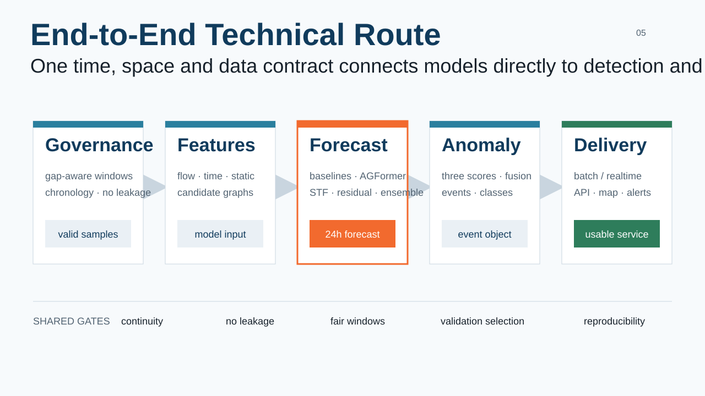

*Figure 2-1. End-to-end route from data governance and forecasting through anomaly fusion, APIs, and visualization.*

The common coordinate contract throughout the system is `timestamp × node_id × channel`. A timestamp aligns every source to the same 30-minute slot. A stable node identifier ensures that flow, static properties, graph edges, anomaly output, and map display refer to the same anonymous area. A channel distinguishes inflow, outflow, and context. This explicit contract avoids two fragile assumptions: that equal file row numbers imply equal geography, or that adjacent array positions imply continuous time.

## 2.2 Seven milestones across the five-month schedule

The report retains Week 1–Week 7 because those names match the existing milestone reports. They denote seven delivery packages, not only seven calendar weeks. The five-month effort can be reconstructed as follows:

| Period | Main activities | Milestone |
|---|---|---|
| Weeks 1–3 | Requirements, literature review, data-source and risk analysis | Week 1 |
| Weeks 4–7 | Cleaning, real timestamps, external alignment, node features, graph structures, data reports | Week 2 |
| Weeks 8–9 | ARIMA/Prophet, LSTM/GRU, GCN/GAT, and STGCN baselines | Week 3 |
| Weeks 10–14 | AGFormer, Spacetimeformer, gating, multi-graph, weather, calendar, linear residual, multi-seed experiments | Week 4 |
| Weeks 15–16 | Three anomaly families, fusion, event merging, classification, sampled verification | Week 5 |
| Weeks 17–18 | End-to-end pipeline, FastAPI, map interface, three-level alerting, deployment documents | Week 6 |
| Weeks 19–20 | Full evaluation, attention and SHAP, anomaly context, system optimization, Optuna plan | Week 7 |

Training and model selection occupied the longest period because each architecture change required protocol inspection, training, log review, evaluation on common windows, ablation, and seed replication. Data engineering was not a one-time preliminary stage: real-time correction, static leakage removal, weather alignment, and display-only map calibration were refined as later experiments exposed problems.

# 3. Data Processing, Feature Engineering, and Graph Construction

## 3.1 Standard flow tensor and node identity

The source flow consisted of fourteen temporal segments. Every timestep contained inflow and outflow on a 32×32 anonymous grid. Preprocessing parsed local date slots into canonical timestamps, checked duplicates, missing values, negative values, range anomalies, and data types, and concatenated the segments into:

```text
data.shape = (22,484, 2, 32, 32)
timestamp.shape = (22,484,)
data type = float32 + datetime64
step = 30 minutes
```

Flattening the grid produced 1,024 nodes, with `node_id = row × 32 + column`. Rows run north to south and columns west to east. The same identifier binds a node's dynamic flow, static attributes, graph edges, model predictions, and anomaly records. A cell is approximately 1.33×1.73 km under the working display extent, but the original source does not contain a fully authoritative geographic bounding box. Training consequently depends on stable row/column topology. The Web map uses a separate visual calibration and does not redefine training metadata.

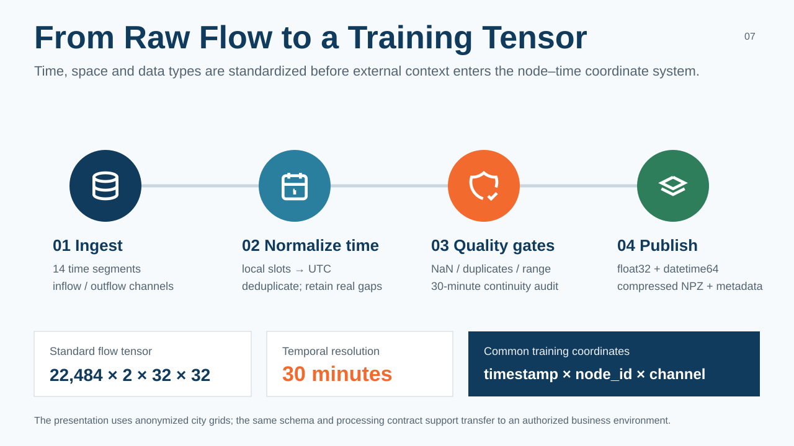

*Figure 3-1. Fourteen flow segments are standardized in time, space, and data type to produce the canonical node–time tensor.*

## 3.2 Gap-aware continuity and leakage-safe splitting

The first window generator used array indexes and assumed that consecutive records were always 30 minutes apart. Segment boundaries, suspended days, and missing observations violate that assumption. The later audit found 73 discontinuities. A window that crosses such a gap teaches the model that data hours or days apart are adjacent targets and can distort both loss and anomaly residuals.

The final sample contains 48 historical and 48 future observations, 96 timestamps in total. It is accepted only when all 95 adjacent time differences equal 30 minutes. The sequence is split chronologically in a 7:1:2 ratio. Means and standard deviations are fitted only on training data and then applied to validation and test data. The strict test set contains 4,022 windows; all final Week 4 comparisons, Week 5 forecast-residual calculations, and Week 7 evaluations use this protocol.

An early cleaning rule interpolated observations with absolute z-scores above five. That can stabilize forecasting but may erase true anomalous activity. The prototype therefore records a production recommendation: preserve an immutable raw mirror, allow forecasting training to use a controlled cleaned view, and return to raw observations during anomaly verification. Cleaning an anomaly and detecting an anomaly are different operations.

## 3.3 Dynamic time, calendar, and weather features

Time features are computed from real timestamps rather than from an array index modulo 48:

| Feature | Dimensions | Purpose |
|---|---:|---|
| inflow / outflow | 2 | Core dynamic flow |
| slot sine / cosine | 2 | Intraday half-hour cycle |
| weekday sine / cosine | 2 | Weekly cycle |
| weekend flag | 1 | Weekend behavior |
| public-holiday flag | 1 | Holiday semantics |
| workday flag | 1 | Shifted working days and make-up days |

The resulting dynamic vector has nine dimensions per node and timestep. The calendar implementation explicitly distinguishes weekends, public holidays, and make-up workdays. Weather preparation produced twelve fields, including temperature, humidity, wind, precipitation, and condition state, and matched all 22,484 timestamps. Nevertheless, a Week 4 ablation found no stable MAE improvement from combined calendar and weather input. Weather was excluded from the final predictor and retained as candidate evidence in Week 7 anomaly-context analysis.

## 3.4 Candidate 41-dimensional and final 33-dimensional static vectors

The candidate static feature vector had 41 dimensions:

| Group | Dim. | Examples |
|---|---:|---|
| Geography | 4 | Normalized position, center distance, ring-band position |
| Distance | 2 | Nearest transport hub and commercial-center distance |
| Road density | 5 | Total, motorway, primary, secondary, and local-road density |
| Functional POI | 11 | Commerce, food, education, medical, office, residential, and other functions |
| Remote sensing | 5 | Built-up, vegetation, water, and brightness summaries |
| Historical flow statistics | 8 | Mean, p99, zero rate, peak, weekend ratio, net direction, coefficient of variation, etc. |
| Transport facility density | 3 | Metro stations, entrances, and bus stops |
| Routes and lines | 3 | Rail lines, interchange indicator, and bus-route count |

Count features use `log1p` before continuous normalization. Functional POI and transport facilities are separated because a dominant count of transport-category POIs made many raw POI vectors artificially similar and weakened the functional-similarity graph.

The eight historical-flow dimensions in columns 27–34 were calculated from the complete time series. If passed to training, a node would carry information about future validation/test means and peaks. The final loader explicitly removes those dimensions and retains 33 truly static geographic, road, POI, remote-sensing, and transport features. This is an important lesson: a time-invariant tensor is not automatically leakage-free; its computation interval must also be audited.

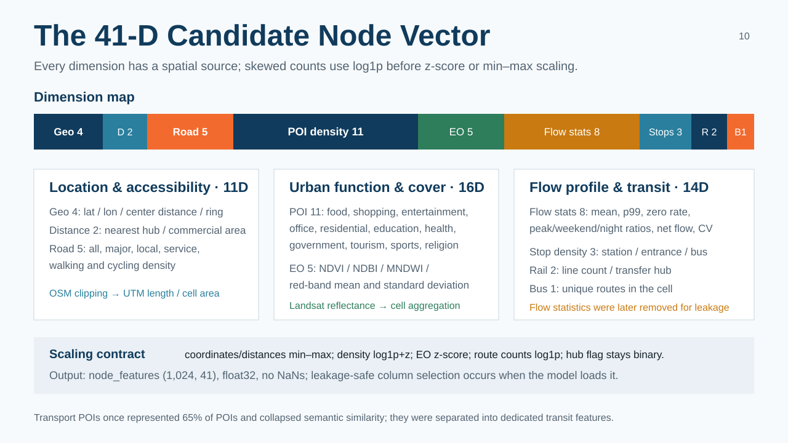

*Figure 3-2. Sources and transformations of the 41 candidate static dimensions and the final 33-dimensional leakage-safe input.*

## 3.5 Four candidate graph structures

Four graphs shared the same 1,024 nodes but encoded different relationships:

1. **Spatial graph.** A Moore eight-neighborhood uses `exp(-d²/1.5²)`, giving approximately 0.641 to orthogonal and 0.411 to diagonal neighbors. It contains 7,812 directed edges, or 7.6 per node on average, and provides the most stable grid prior.
2. **POI graph.** Eleven functional-POI densities are transformed by `log1p`, L2-normalized, and compared by cosine similarity. Each node selects ten neighbors, yielding 10,240 edges and links between distant but functionally similar areas.
3. **Flow-correlation graph.** Each node selects its fifteen strongest positive Pearson inflow correlations, yielding 15,255 edges. The original version used the complete series and could duplicate history information; it is not used in the final production candidate. Any future reuse must rebuild it from training data only.
4. **Transit graph.** Rail topology connects stations within at most ten hops, with bidirectional weight `exp(-hops/3)`. Its 3,080 edges describe propagation along lines rather than straight-line proximity.

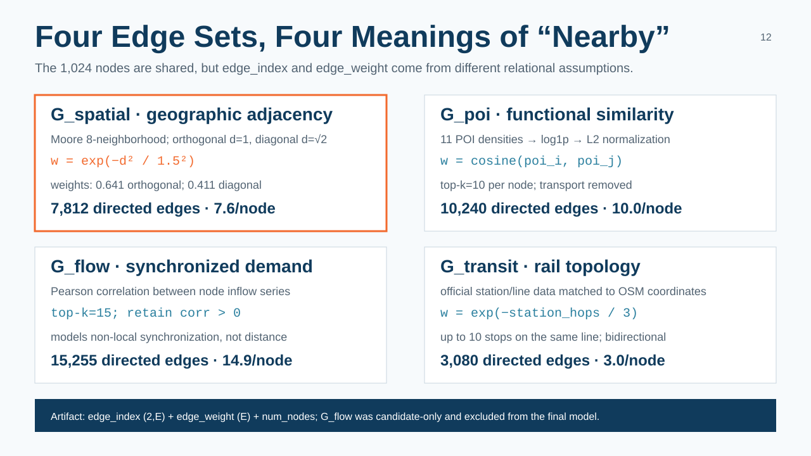

*Figure 3-3. Construction rules for spatial, functional, historical-correlation, and public-transport relationships.*

Every graph stores `edge_index(2,E)`, `edge_weight(E)`, and `num_nodes`. The Week 4 multi-graph experiment did not support the assumption that more semantic graphs automatically help. Learned global weights placed 92.18% on the flow graph while almost suppressing the POI and transit graphs. The final predictor therefore uses one explicit spatial graph plus a separately learned dense adaptive adjacency.

# 4. Forecasting Baselines, Metrics, and Experimental Protocol

## 4.1 Common task and metrics

Week 3 established runnable baselines before optimizing the final architecture. The target is 48-step future inflow. Metrics are computed after inverse scaling on the original flow scale. MAE is the primary forecasting and later residual-anomaly metric; RMSE emphasizes rare large errors; MAPE provides relative error but is unstable at very small targets and is therefore calculated with a nonzero/stabilized mask.

The reported h1, h3, h6, and h12 values aggregate from the forecast origin through the respective number of half-hour steps; they are not isolated errors at the third, sixth, or twelfth forecast step. They cover 0.5, 1.5, 3, and 6 hours. `avg` covers the complete 24-hour horizon. This convention makes error growth easy to inspect but must be stated explicitly during presentation.

## 4.2 Statistical baselines

ARIMA experiments applied ADF stationarity checks, ACF/PACF inspection, AIC order selection, and Ljung–Box residual tests to representative nodes, leading to a concentrated `ARIMA(2,0,1)` global configuration. Prophet enabled daily and weekly seasonality and extrapolated the test period from a fixed fit. Initial 24-hour MAEs were approximately 44.73 for ARIMA and 43.81 for Prophet, substantially worse than the neural baselines. Ljung–Box results also indicated residual autocorrelation, meaning that predictable periodic structure remained.

These baselines provided an interpretable lower bound rather than the final candidate. If a complex system had failed to outperform them, data or implementation would have required reinspection. Per-node statistical fitting also scales poorly to 1,024 regions, shares little information across regions, and cannot directly exploit graph or multi-source context.

## 4.3 Sequence and graph baselines

LSTM and GRU used a shared temporal encoder across nodes. GCN and GAT flattened history into node features and propagated them through the spatial graph. With an initial six-hour history, LSTM/GRU average MAE was about 29, while pure GCN/GAT remained around 33–37, demonstrating that spatial propagation without a dedicated temporal module was insufficient. Extending history to 24 hours reduced LSTM and GRU MAE to approximately 20.34 and 20.43. Extending the sequence to a full week did not improve it further, showing that a longer input is not automatically useful.

STGCN alternated temporal and graph convolution and supported the direction of joint spatiotemporal learning, although fixed graphs and convolutional receptive fields still limited flexibility. A multi-graph STGCN variant likewise showed that simply stacking relationships does not ensure useful fusion. Week 3 therefore established two conclusions: temporal dependence is a strong baseline, and spatial structure must be integrated with—not substituted for—a competent temporal module.

## 4.4 Early versus final protocol

Some Week 3 numbers predate the real-time gap audit. They remain useful for comparing model-family trends but cannot be mixed directly with the final Week 4 table. After the timestamp correction, LSTM was rerun with the same 4,022 test windows and multiple seeds; its 24-hour average was MAE 19.4941, RMSE 36.8806, and MAPE 34.64%.

This correction created an important experimental rule: implementation success does not make a metric final. When data rules change, important baselines must be rerun and older results must retain their scope. Final selection prioritizes common windows and splits and distinguishes clearly among one seed, the mean of independent seeds, and a prediction ensemble.

# 5. Model Design, Ablation, and Final Selection

## 5.1 Project-specific AGFormer

AGFormer denotes the project's Adaptive Graph Transformer for Spatio-Temporal Prediction. It is an original task-oriented combination, not an exact reproduction of a similarly named external paper and not a literal concatenation of complete STGCN and Graph WaveNet systems. A block follows:

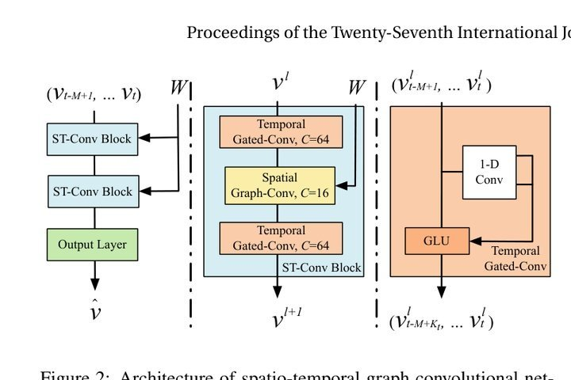

*Figure 5-1. The original STGCN architecture with stacked ST-Conv blocks and an output layer. Source: Yu et al., IJCAI 2018, Figure 2 [1]. This project adopts explicit graph propagation but not the complete temporal-convolution design.*

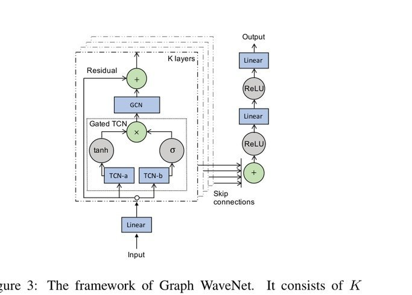

*Figure 5-2. The original Graph WaveNet framework. Source: Wu et al., IJCAI 2019, Figure 3 [2]. The project borrows node-embedding adaptive adjacency but does not reproduce the full dilated causal-convolution stack.*

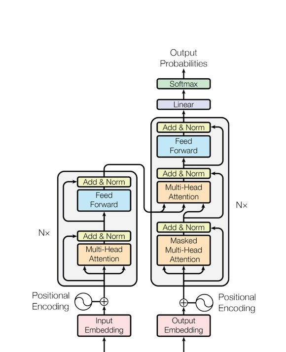

*Figure 5-3. The original Transformer encoder–decoder architecture. Source: Vaswani et al., NeurIPS 2017, Figure 1 [3]. The project retains multi-head self-attention, residuals, LayerNorm, and FFN for each node's 48-step temporal sequence.*

```text
Per-node temporal multi-head self-attention
        ↓ residual + LayerNorm
Predefined spatial DenseGCN + adaptive adjacency propagation
        ↓ sum + ReLU + residual + LayerNorm
Feed-forward network
        ↓ residual + LayerNorm
```

For each node, the 48 historical half-hour observations form a sequence. Two Transformer layers with four heads and `d_model=32` apply temporal self-attention with sinusoidal positional encoding. The explicit spatial path propagates through the normalized fixed grid adjacency. The adaptive path learns two node embeddings, `E1` and `E2`:

```text
A_adaptive = softmax(ReLU(E1 × E2ᵀ))
```

At each timestep, fixed-graph and adaptive-graph outputs are added. The former supplies stable local prior knowledge and reduces the search space; the latter can represent distant or otherwise latent relationships. Unlike full Graph WaveNet, the project model does not reproduce its dilated causal-convolution stack. Unlike STGCN, it replaces temporal convolution with Transformer attention.

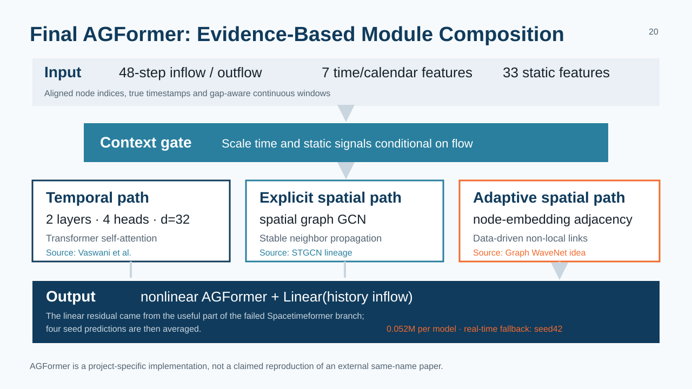

*Figure 5-4. Project-specific AGFormer inputs, gated context, temporal attention, explicit spatial graph, adaptive graph, and linear residual path. This is a project implementation diagram, not an external paper figure.*

## 5.2 Gated context fusion

Flow, time/calendar variables, and static node features have different scales and reliability. Direct concatenation can allow weak context to overwhelm the main signal. The gated design separately projects flow and context and lets the current flow state determine how much context to inject:

```text
h_flow = Linear(flow)
context = Merge(TimeProjection, StaticProjection)
gate = sigmoid(Linear([h_flow, context]))
h = h_flow + gate × context
```

The same holiday or commercial-area feature need not matter equally under every flow state. In the ablation, time-plus-static AGFormer averaged MAE 16.9376 across three seeds, while gated context at seed 42 reached 16.5350 and became the strongest single model before the linear residual head.

## 5.3 Progressive Spacetimeformer alignment

Spacetimeformer represents each variable–time pair as a token and can learn global spatiotemporal relationships directly. In theory this is more general than a fixed graph model. In this project, however, 1,024 nodes and 48 context steps yield 49,152 context tokens, making unrestricted quadratic attention impractical. Alignment was therefore incremental:

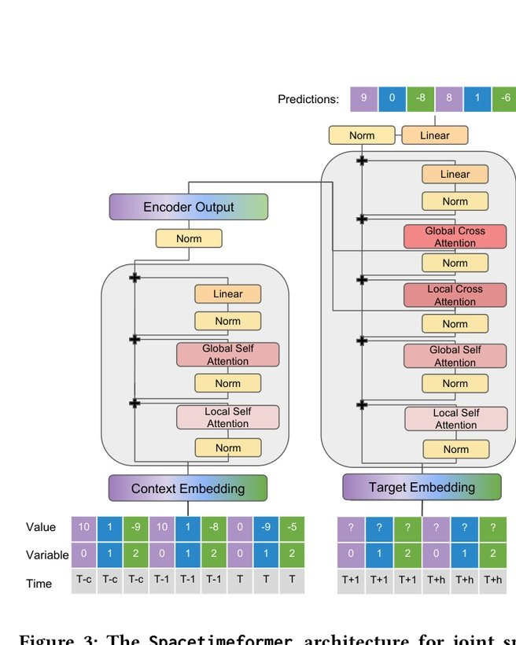

*Figure 5-5. The original Spacetimeformer architecture for joint spatiotemporal forecasting. Source: Grigsby et al., arXiv:2109.12218, Figure 3 [4]. The project aligns value/time, given/missing, context/target tokens, and local/global attention, while approximate global attention remains necessary for 49,152 context tokens.*

1. adopt real timestamps, gap-aware windows, and 33-dimensional leakage-safe static features;
2. match parameter count to AGFormer to test the “model too small” hypothesis;
3. add local temporal and linear global spatiotemporal attention;
4. separate value and time embeddings and introduce given/missing embeddings;
5. add encoder context tokens, decoder target tokens, and fuller cross-attention;
6. ablate future-time context, linear output, and gated context.

The light real-time-context version achieved MAE 17.9967. Increasing capacity worsened MAE to 18.6715, indicating that size was not the main bottleneck. In the more paper-aligned implementation, disabling future-time context improved MAE from 18.4433 to 18.2950; the decoder's future-time information appeared noisy under the current target and data. A linear output path produced the largest recovery, to 17.0688, but the model still did not surpass AGFormer.

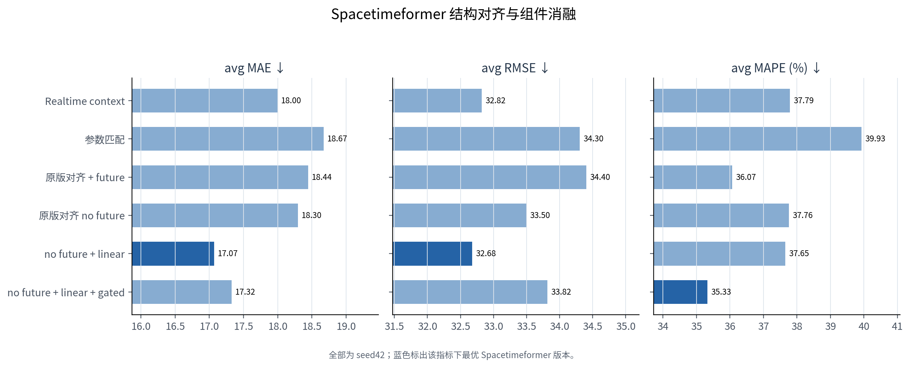

*Figure 5-6. Main Spacetimeformer experiments from parameter matching through paper-style embeddings, future-time context, linear output, and gated context.*

This does not establish that Spacetimeformer is generally inferior. Under this regular grid, sample scale, long output horizon, and compute budget, explicit spatial priors were more sample-efficient. Token attention had to relearn relationships and rely on approximate attention. The negative result rejected the assumption that a larger or more paper-aligned model must win, while exposing the linear path that later improved AGFormer.

## 5.4 Calendar, weather, graph, and periodic-lag ablations

Feature and graph experiments were performed under the repaired time protocol. Completing the shifted-workday calendar slightly increased MAE. Adding aligned weather also failed to deliver a stable improvement, likely because calendar signals overlapped with the existing cyclic encodings and citywide weather lacked node-level spatial detail. The features remain useful for interpretation, but they were not forced into the final predictor.

The four-graph AGFormer learned a dominant 92.18% weight on the flow-correlation graph. This did not improve final accuracy and introduced a leakage concern because the first flow graph was built from the complete series. The selected architecture therefore retained only the safe spatial graph and the model's adaptive adjacency.

Periodic input added previous-day `lag_48`, previous-week `lag_336`, and current-minus-lag differences. It was tested only on the 3,433 windows for which all required history existed. A baseline was reevaluated on exactly the same subset; periodic features did not win. This subset control mattered: comparing a 3,433-window result against a 4,022-window baseline would confound features with sample composition.

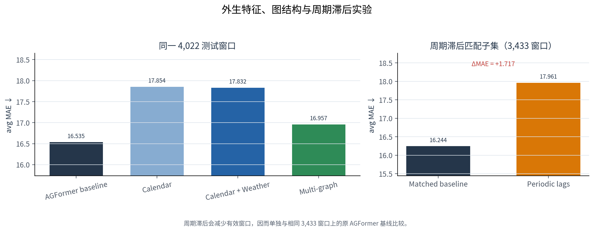

*Figure 5-7. Calendar, weather, periodic-lag, and graph-related ablations under controlled evaluation scopes.*

## 5.5 Linear residual output and multi-seed ensemble

The linear head runs in parallel with the nonlinear AGFormer branch rather than replacing it:

```text
prediction = nonlinear_AGFormer(history, graph, context)
           + linear_projection(recent_flow)
```

Ride-hailing flow contains strong local persistence. A high-capacity nonlinear branch can spend parameters relearning that nearly linear component and become sensitive to optimization. The direct path provides a low-variance autoregressive route while the Transformer/graph branch focuses on nonlinear residuals and spatial interaction.

Four independent seeds were trained and verified:

| Seed | Average MAE | Average RMSE | Average MAPE |
|---:|---:|---:|---:|
| 42 | 16.1132 | 30.3198 | 36.91 |
| 7 | 16.9079 | 31.9627 | 39.75 |
| 21 | 16.4172 | 31.2766 | 36.51 |
| 123 | 16.5463 | 31.1309 | 38.10 |

Mean MAE across the four independent runs was `16.4961 ± 0.2850`, confirming that the linear-head improvement was not limited to seed 42.

The prediction-level ensemble averages the four model outputs, rather than averaging their metric values. On the common 4,022-window test set it achieved:

| Horizon | MAE | RMSE | MAPE |
|---|---:|---:|---:|
| h1 / 0.5 h | 11.3019 | 19.8621 | 23.49 |
| h3 / 1.5 h cumulative | 12.6473 | 22.9856 | 26.18 |
| h6 / 3 h cumulative | 13.4194 | 24.7530 | 28.28 |
| h12 / 6 h cumulative | 14.1068 | 26.2676 | 30.66 |
| Full 24 h | **15.9030** | **30.2250** | **35.44** |

Compared with the best seed, ensemble MAE improved by 1.30% and RMSE by 0.31%. The improvement is modest but consistent with variance reduction, and it was obtained without changing the test set or tuning on test outcomes. This ensemble became the final forecasting candidate and the forecast-residual source for the anomaly module.

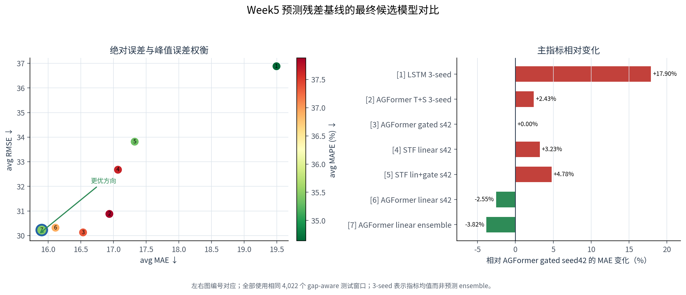

*Figure 5-8. Comparable gap-aware model results and the final ensemble.*

# 6. Three-Branch Anomaly Detection, Event Fusion, and Classification

## 6.1 Weak-supervision task definition

The historical dataset does not provide authoritative anomaly-event labels. The project therefore used two levels of weak labels for development and explicitly separated them from ground truth. Level A is a strict statistical departure that supports primary comparison. Level B is a broader exclusion rule used to identify weak-normal training windows for reconstruction models. Directional evaluation further separates high, low, and bidirectional anomalies because demand surges and collapses can have different operational meanings.

This design supports reproducible method comparison, but it has circularity: a statistical detector is naturally close to statistically generated labels. Consequently, the report includes timestep and event-level results, a 50-event manual-review CSV, and per-method evidence. It never presents weak-label F1 as verified real-world recall.

## 6.2 Statistical branch: 3σ and IQR

For every node and calendar slot, the statistical branch estimates a normal profile from training history. A value outside mean ± three standard deviations or beyond the IQR fences becomes evidence of deviation. Slot conditioning prevents routine rush-hour demand from being compared with midnight demand. Both upper and lower tails are retained so that unusual drops are not hidden by high-only evaluation.

The strength of this branch is direct interpretability: an operator can inspect the normal range, z-score, and IQR departure. Its limitation is equally clear: seasonality or regime changes not represented in the grouping can raise false positives, and a large recurrent event may be absorbed into the “normal” range.

## 6.3 Reconstruction branch: VAE and Transformer autoencoder

The VAE learns a probabilistic latent representation and treats high reconstruction error as evidence that a window does not resemble normal history. The Transformer autoencoder uses attention to reconstruct temporal relationships and can model longer dependencies. Both models were changed to train only on weak-normal windows: every timestep in a training window must be free of Level-B weak anomalies. This avoids teaching an autoencoder to reconstruct the very deviations it should identify.

Reconstruction error is calibrated before fusion because its raw scale differs from z-scores and forecast residuals. A high error is evidence of pattern novelty, not proof of a dangerous event. The two autoencoders are members of one reconstruction family rather than extra independent votes, which prevents overcounting correlated evidence.

## 6.4 Forecast-error branch

The final four-seed predictor produces an expected inflow. Its absolute and normalized residuals answer a useful counterfactual question: did the observation deviate from what a strong model expected after seeing recent flow, calendar context, static node properties, and graph relationships? This distinguishes predictable high demand from surprising activity.

Forecast residuals inherit model bias. Nodes or time periods that are difficult to predict can appear anomalous more often, so the branch requires node/time calibration and must be read with the Week 7 error audit. It complements but cannot replace statistical and reconstruction evidence.

## 6.5 Calibration and weighted soft voting

Raw outputs from the three families are placed on comparable score scales and fused through weighted soft voting. Validation selected:

```text
statistical weight      = 0.70
reconstruction weight   = 0.20
prediction weight       = 0.10
decision threshold      = 0.56
selection split         = validation
final evaluation split  = test
```

The statistical method dominates because it aligned most reliably with the available weak labels. Reconstruction and residual scores add independent pattern and counterfactual evidence. Parameters and label rules are written directly into result summaries, not only hidden in a configuration file, so that a report reader can reproduce the decision.

Under Level-A weak labels, timestep precision was 0.4322, recall 0.5688, and F1 0.4912. The result balances broad coverage against a moderate number of false alarms. This may be appropriate for safety screening, but the operational threshold must ultimately be selected from verified event costs rather than proxy F1 alone.

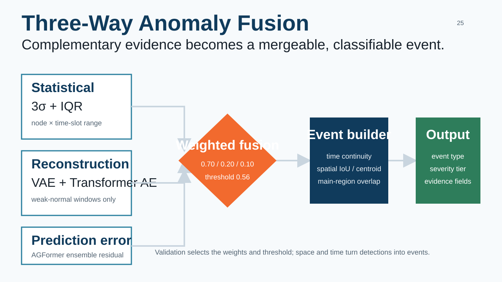

*Figure 6-1. Statistical, reconstruction, and forecast-error evidence flows through validation-selected weights, thresholding, spatial clustering, and event classification.*

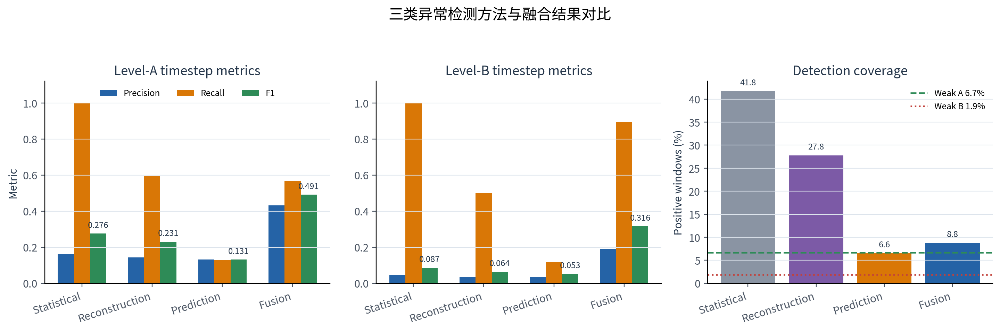

*Figure 6-2. Statistical, reconstruction, prediction-residual, and fused detection under the fixed weak-label protocol.*

## 6.6 Spatially continuous event formation

A binary node-time mask is not yet an event. Anomalous cells in each frame are first clustered. Consecutive clusters are linked only if temporal continuity and at least one spatial criterion hold: cluster IoU ≥ 0.05, centroid distance ≤ 4 grid cells, or overlap in a principal anomalous region. This prevents two consecutive but geographically unrelated anomalies from becoming one event.

The test period produced 131 fused candidate events. One-to-one event matching against 118 Level-A reference events yielded 60 matches: precision 0.4580, recall 0.5085, and F1 0.4819 under the weak protocol. These values quantify agreement with proxy events, not verified real-world detection, and the unmatched candidates still require human review.

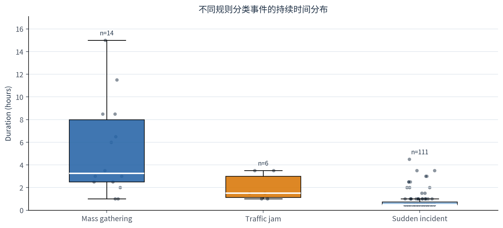

*Figure 6-3. Distribution of fused events by severity and duration.*

## 6.7 Candidate classification and explainability fields

Classification uses descriptive rules rather than supervised labels. Features include event area, duration, aspect ratio, road density, inflow/outflow imbalance, appearance and decay trend, cluster count, and spatial concentration:

- **Mass gathering:** concentrated or broad-area persistence with jointly elevated inflow and outflow.
- **Traffic congestion:** elongated road-adjacent shape, longer duration, and directional imbalance.
- **Sudden incident:** abrupt onset, shorter duration, or localized/multi-point pattern.

Every event preserves `statistical_score`, `reconstruction_score`, `prediction_score`, `dominant_method`, top cells, maximum z-score, maximum reconstruction error, and maximum prediction residual. These fields answer “why did the system flag this event?” without claiming a confirmed cause. Fifty events were sampled for sanity checking: 20 high-confidence, 15 borderline, and 15 apparent false positives under weak labels, with time, area, flow, scores, and candidate class exported for mentor review.

# 7. System Implementation: Pipeline, API, Web Map, and Alerting

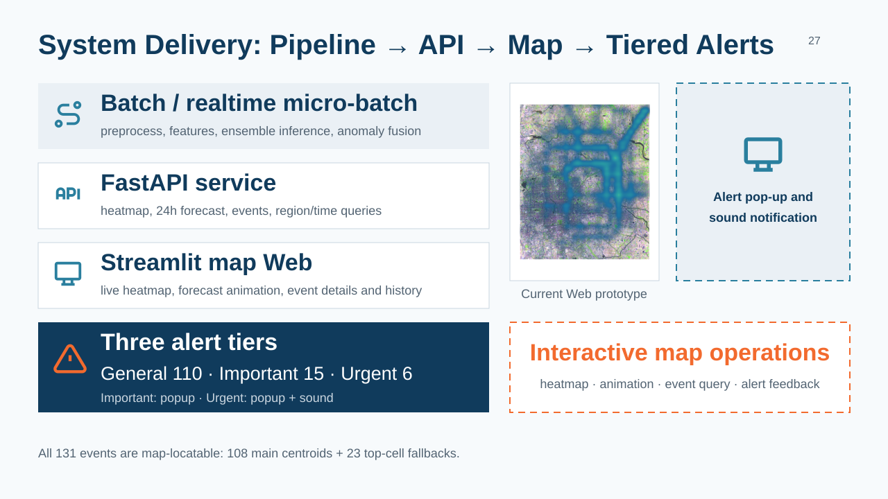

*Figure 7-1. Relationship among batch/realtime processing, FastAPI query services, map visualization, and three-level alerting. The interface image is from the project prototype.*

## 7.1 Batch and realtime micro-batch pipelines

The end-to-end runner encapsulates preprocessing, feature assembly, model loading, forecast inference, anomaly scoring, event formation, and atomic artifact publication. Batch mode processes a historical range and produces evaluation/report artifacts. Realtime mode is a controlled micro-batch simulator: it reads newly available observations, validates continuity, executes inference without retraining, and publishes a new coherent artifact set.

Configuration and checkpoint fingerprints prevent silent reuse of incompatible models. A reconstruction checkpoint records its model hyperparameters, data path, split information, scaler identity, label-rule parameters, and configuration hash. Missing or mismatched artifacts fail fast instead of silently returning plausible but stale output. Atomic replacement prevents API readers from observing a partially written forecast/event set.

## 7.2 FastAPI inference service

The service exposes versioned REST endpoints:

| Method | Endpoint | Function |
|---|---|---|
| GET | `/health`, `/ready` | Process health and artifact readiness |
| GET | `/api/v1/status` | Model, artifact, and degraded-state summary |
| GET | `/api/v1/heatmap/current` | Current observed grid heatmap |
| GET | `/api/v1/forecast` | Region/time-filtered prediction |
| GET | `/api/v1/forecast/frames` | One-origin 48-frame animation payload |
| GET | `/api/v1/anomalies/events` | Event query by time, region, type, severity, or score |
| GET | `/api/v1/alerts` | Three-level product alert query |
| GET | `/api/v1/statistics` | Event-type, level, and temporal statistics |

The API does not train models inside requests. If a necessary inference artifact is unavailable, business endpoints return 503 while status remains available and reports `degraded`. The current prototype does not implement authentication; deployment must bind to localhost/private networking or sit behind an authenticated TLS/VPN reverse proxy.

## 7.3 Map-centered Streamlit interface

The Web interface uses the map as its primary component. It displays current observation and prediction heatmaps, animates 48 future frames from one forecast origin, shows anomaly markers and details, filters historical events, aggregates type/level/time statistics, and supports automatic refresh. Important alerts show a banner and pop-up; emergency alerts add a red high-priority notification and sound. Session state records acknowledged event IDs so that every refresh does not repeat the same interruption.

The background reuses a project-acquisition-stage Landsat image reprojected to WGS84 and adds ring-road reference overlays. Since the flow grid lacks an authoritative bounding box, only the display overlay is calibrated: its 32×32 orientation and scale are preserved while north/south and east/west offsets can be adjusted. Training `grid_meta`, node IDs, static features, graph edges, forecasts, and anomaly outputs are unchanged. Visual calibration therefore does not alter Week 4/5 metrics and is not proof of exact absolute geolocation.

## 7.4 Three-level alert mechanism

Week 5 retains research severity levels 1–4. Week 6 maps them into product behavior without overwriting the original field: severity 1–2 becomes **general** and appears in lists/maps; severity 3 becomes **important** and triggers map emphasis, a banner, and a pop-up; severity 4 becomes **emergency** and adds an urgent red message and sound. Of 131 historical events, 110 were general, 15 important, and 6 emergency. Only 21 produced pop-ups, reducing alert fatigue.

Separating detection severity from interface behavior allows later operational adjustment. If manual review shows that one class has excessive false alarms, the product mapping can change without destroying the reproducibility of the Week 5 event output.

# 8. Experimental Results, Explainability, and Performance Optimization

## 8.1 Final accuracy and error structure

The final ensemble results on the 4,022 strict test windows are:

| Range | Covered time | MAE | RMSE | MAPE |
|---|---:|---:|---:|---:|
| h1 | 0.5 h | 11.3019 | 19.8621 | 23.49 |
| h3 | 1.5 h cumulative | 12.6473 | 22.9856 | 26.18 |
| h6 | 3 h cumulative | 13.4194 | 24.7530 | 28.28 |
| h12 | 6 h cumulative | 14.1068 | 26.2676 | 30.66 |
| avg | 24 h | **15.9030** | **30.2250** | **35.44** |

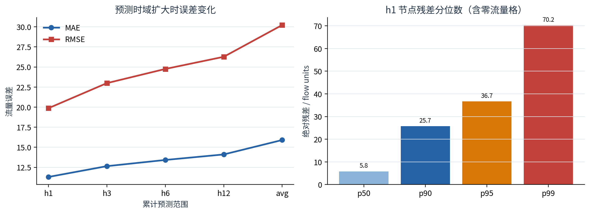

*Figure 8-1. Error grows with the forecast range, and h1 node residuals have a long tail.*

Across 1,024 nodes, median h1 MAE was 9.4145 and P90 was 21.3621; the hardest node, grid 157, reached 43.8480. By time of day, 16:00 had MAE 24.4416, materially above most slots. These differences show that a global average cannot replace node-level and time-slot audits. Local calibration, hierarchical losses, or uncertainty-aware thresholds could target the difficult regions.

## 8.2 Temporal attention and adaptive spatial graph

Attention analysis sampled all four checkpoints, four dates spanning the beginning, middle, and end of the test set, and both AGFormer layers. Aggregated normalized temporal-attention entropy was 0.9956, and attention mass over the nearest three hours was 0.1223. Layer one emphasized lags about 9.5–13 hours back, while layer two attended both to the most recent observations and to approximately 8.5–9.5 hours back. The high aggregate entropy indicates distributed attention after averaging across models and samples. It does not prove that every individual example lacks a key lag, nor does attention itself establish causal importance.

The adaptive adjacency had mean row entropy 0.7261 and mean top-k concentration 0.2238, showing that node embeddings learned non-uniform relationships. This view explains only the nonlinear learned-graph branch. It excludes the predefined spatial GCN and parallel linear residual head, so it must not be described as a complete decomposition of spatial influence.

## 8.3 TreeSHAP behavioral surrogate

To explain full four-seed ensemble h1 behavior, the project fitted a time-held-out ExtraTrees surrogate and decomposed it with TreeSHAP. The surrogate reached R² 0.9926 and MAE 4.4381 flow units, with mean SHAP additivity error about `4.13×10^-6`. Historical inflow and outflow represented 49.80% and 47.63% of mean absolute SHAP importance, totaling 97.43%; time/calendar features accounted for 2.33%, and static groups were small in the global aggregation.

The leading variables were recent half-hour lags 1–4 and lags 46–48 near the previous-day boundary, confirming short-term persistence and daily context. Low global static importance does not mean static features are useless: compressed proxy input, gating interactions, node conditioning, and global averaging dilute an individual group's mean absolute SHAP share. TreeSHAP explains a high-fidelity behavior surrogate, not direct gradients of the neural network, so surrogate quality must always accompany the plot.

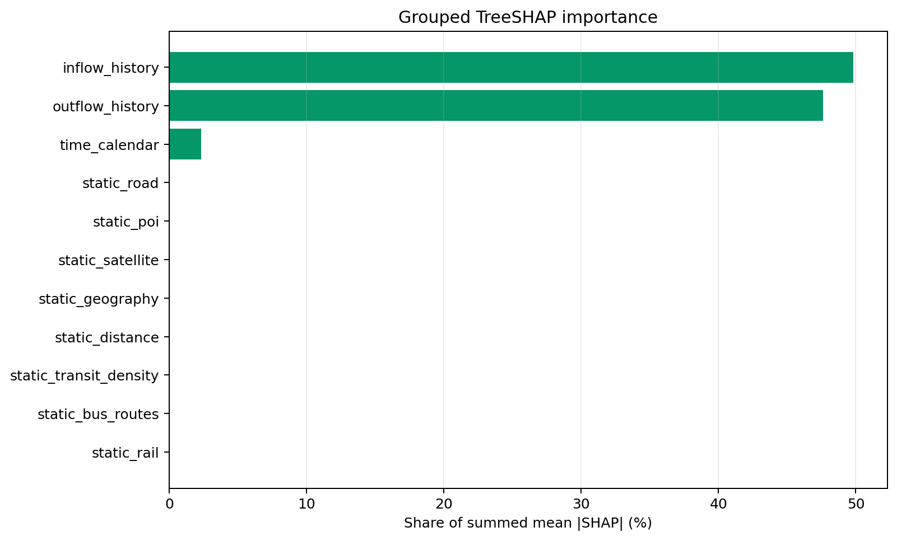

*Figure 8-2. Mean absolute TreeSHAP shares for historical flow, calendar, and static groups in the ensemble behavioral surrogate.*

## 8.4 External context for anomaly interpretation

Of 131 fused events, 46 matched candidate extreme-temperature context, 17 matched strong wind, 13 occurred on a public holiday, 3 on a shifted working day, and 3 exhibited a weekend context. Forty-nine had no matched external context. Weather coverage was complete for the studied timestamps, but no verifiable news or event table was configured, so news matches correctly remained zero.

These are **candidate contextual associations**, not causal findings. Co-occurrence with weather does not prove that weather caused the flow event, and the rule-based `event_type` is a morphological label. Retaining “unknown” is more reliable than automatically inventing an explanation for every anomaly.

## 8.5 System performance optimization

The benchmark fixed the last 24 valid test windows and compared the same model, output, and anomaly rules. Optimizations included sharing one full-sequence inference between h1 and Web forecast outputs; caching time-slot statistics by data SHA-256, training length, timezone, and rule parameters; disabling unused attention-weight materialization; reducing DataLoader workers from two to zero for small micro-batches; and caching API event-time conversion and coordinate joins with modification-time invalidation.

| Variant | Pipeline seconds | Peak RSS MiB | Peak CUDA MiB |
|---|---:|---:|---:|
| Baseline FP32 | 6.416 | 3881.5 | 826.2 |
| Optimized cold FP32 | 6.106 | 2793.2 | 703.7 |
| **Optimized warm FP32** | **4.613** | **1791.2** | **703.7** |
| Optimized warm FP16 | 4.596 | 1894.4 | 419.7 |

Warm FP32 was selected for deployment: 1.39× end-to-end speed-up, 53.9% lower aggregate process-tree RSS, and 14.8% lower peak CUDA memory. Batch size eight had the lowest median model latency in the scan; batch 24 raised memory to roughly 2,074 MiB and was slower. FP16 passed numerical tolerances but delivered only 0.9945× speed, below the 1.05× deployment gate. Dynamic INT8 was approximately 1.305× faster only in a CPU single-model microbenchmark and did not cover the production CUDA ensemble, so it was not deployed.

Historical-event and statistics endpoints improved by about 1.59× and 1.69×. Full heatmap and 48×1024 forecast JSON became slightly slower because the bottleneck moved to Python-object construction, serialization, and compression. The project therefore does not claim that every endpoint improved.

## 8.6 Optuna hyperparameter optimization plan

Time and GPU limits allowed an executable Optuna plan and code implementation but not a completed search; this report does not invent best parameters. The plan freezes data, split, nine-dimensional dynamic input, 33-dimensional static features, single spatial graph, gated fusion, linear head, Huber loss, and metric rules. It searches learning rate, batch size, `d_model`, attention heads, FFN multiplier, number of layers, dropout, weight decay, and adaptive-embedding dimension.

The proposed study uses TPE, 30 trials, an 18-hour soft wall-clock limit, serial single-GPU execution, MedianPruner, resumable SQLite storage, and a protocol fingerprint. The objective constructs only training and validation data. The top five candidates receive equal-budget full validation training; at least 0.5% improvement over the same-round incumbent is required before four-seed replication. Only after stability gates pass can explicit `--run-final-test` access the 4,022-window test set once. This prevents repeated test inspection from becoming an implicit tuning signal.

# 9. Integrated Results, Project Highlights, and Technical Challenges

## 9.1 From research prototype to operational chain

The main outcome is not a single error number but a traceable chain. Half-hourly gridded flow moves through continuity checking, train-fitted scaling, feature and graph construction, and multi-model forecasting. Forecast residuals join statistical and reconstruction evidence to form typed and graded events. Batch, realtime micro-batch, REST, and map layers expose those events. A fixed Week 7 benchmark then evaluates accuracy, latency, memory, and explanation artifacts.

The final forecasting candidate is the four-seed AGFormer-plus-linear ensemble, with 24-hour MAE 15.9030 and h1 MAE 11.3019. The anomaly system avoids presenting proxy F1 as business truth: it includes high/low/bidirectional directions, timestep and event-level evaluation, a 50-event review sheet, and explanatory fields. Research severity and product alert behavior remain separate, allowing thresholds and notification policies to evolve without invalidating experimental artifacts.

## 9.2 Principal contributions and highlights

1. **Strict temporal leakage prevention.** Chronological splitting before windowing, continuity validation, train-only scaling, removal of future-derived static statistics, and an Optuna validation/test gate create a consistent protocol.
2. **Joint fixed-graph and adaptive-graph modeling.** The fixed grid encodes reliable local propagation; learned adjacency supplies data-driven non-local structure; 33 static node features and real-time context enter through gates.
3. **Selection driven by ablation, not model reputation.** Calendar, weather, multi-graph, periodic-lag, future-time context, paper-style Spacetimeformer elements, and linear residual paths were tested separately. Negative results were preserved, and useful components were transferred.
4. **Three-family anomaly fusion and event representation.** Calibrated soft voting combines statistical, reconstruction, and counterfactual residual evidence. Spatial continuity prevents isolated cell alarms from being exposed directly as business events.
5. **A research-to-engineering evaluation loop.** The same candidate undergoes multi-seed accuracy checks, attention and SHAP interpretation, latency/RSS/CUDA benchmarking, API caching tests, and deployment-boundary review.

## 9.3 Major challenges and responses

**Temporal discontinuity** was the first major challenge. Index-based windows can silently cross real gaps. The solution made timestamp continuity part of sample construction and wrote valid-sample counts into results.

**Heterogeneous context** was the second. Flow, calendar, weather, POI, road, and transport features differ in scale, variability, and trust. Candidate features were built first and admitted to the final model only after availability/leakage audits and ablation. Eight complete-series flow summaries were removed despite appearing “static.”

**Model complexity did not guarantee improvement.** Progressive Spacetimeformer alignment and parameter matching did not beat AGFormer. The data volume, grid size, long output horizon, attention approximation, and optimization budget constrained the general architecture. The simpler linear residual improved AGFormer because it matched strong short-term autocorrelation and allowed the nonlinear branch to focus on residual structure.

**Anomaly truth was absent.** Weak labels enabled comparison but introduced circularity. Directional/event evaluation, a sampled-review sheet, method contributions, and candidate external evidence reduce overinterpretation, but they do not replace verified labels.

**Geographic metadata was incomplete.** Only the display overlay was shifted to align the visual ring structure. Training nodes, static features, graphs, predictions, and anomaly events were left unchanged. The limitation is documented instead of modifying experimental coordinates for cosmetic consistency.

# 10. Evaluation Boundaries, Limitations, and Improvements

Forecast metrics come from a fixed historical test period. They support within-protocol comparison but do not establish cross-city, cross-season, or drift robustness. The four-model ensemble reduces variance but increases inference cost. Distillation, a shared backbone, or uncertainty-triggered ensembling could retain part of the gain. High-peak slots and a small set of difficult nodes remain disproportionate error sources; node-stratified losses, quantile forecasting, and calibrated prediction intervals are promising next steps.

The principal anomaly limitation is the absence of expert truth. Weak labels are generated from the same flow stream, so detectors similar to those rules receive a structural advantage. The 50-event table is a review aid, not a formal annotation set. A production study should use two independent reviewers plus adjudication, then report event precision/recall, detection delay, false-alarm interval, and cost by alert level. Fusion weights and thresholds should be relearned on that validation truth.

External evidence currently covers weather and calendar, while verified news/activity evidence is empty. Candidate classes should therefore be understood as spatiotemporal morphology, not confirmed causes. With authorized road-state, event, and activity feeds, the system could retain auditable links and distinguish correlation, plausible cause, and confirmed cause. Authoritative grid boundaries and a coordinate reference system are also necessary before map output supports field response.

The prototype does not yet provide authentication, authorization, rate limiting, a message queue, persistent event storage, online drift monitoring, or high availability. Production deployment requires private networking or an authenticated TLS proxy, data/model registries, rollback, audit logs, Prometheus-style telemetry, and staged release. Optuna code exists but has not been run; any future search must use fixed resources, validation-only selection, multi-seed replication, and one final test access.

# 11. Conclusion and Outlook

This project completed an end-to-end cycle for urban crowd-flow awareness in a ride-hailing safety context: data governance; feature and graph construction; forecasting-model comparison; fused anomaly detection; APIs and visualization; and explanation and performance audits. The work showed that reliable improvements came more often from repaired temporal semantics, leakage control, disciplined ablation, and architecture aligned with data regularities than from simply enlarging a Transformer. The AGFormer-plus-linear multi-seed ensemble became the final Week 4 forecaster; three-branch event detection formed Week 5; and Weeks 6–7 converted research artifacts into a queryable, explainable, and measurable system prototype.

Prioritized future work is to establish verified event labels and an operator feedback loop; acquire authoritative geographic metadata and authorized external-event evidence; run the gated Optuna protocol and replicate across periods; study probabilistic forecasts, anomaly uncertainty, and drift; and improve online efficiency through distillation, caching, batching, and asynchronous event storage. The long-term objective is not merely a lower offline MAE or higher proxy F1, but a reproducible, explainable, operable, and continuously calibrated decision-support capability for urban crowd safety.

# References

[1] Yu, B., Yin, H., & Zhu, Z. *Spatio-Temporal Graph Convolutional Networks: A Deep Learning Framework for Traffic Forecasting*. IJCAI, 2018.

[2] Wu, Z., Pan, S., Long, G., Jiang, J., & Zhang, C. *Graph WaveNet for Deep Spatial-Temporal Graph Modeling*. IJCAI, 2019.

[3] Vaswani, A., et al. *Attention Is All You Need*. NeurIPS, 2017.

[4] Grigsby, J., Wang, Z., Nguyen, N., & Qi, Y. *Long-Range Transformers for Dynamic Spatiotemporal Forecasting*. arXiv:2109.12218, 2021.

[5] Kingma, D. P., & Welling, M. *Auto-Encoding Variational Bayes*. ICLR, 2014.

[6] Lundberg, S. M., & Lee, S.-I. *A Unified Approach to Interpreting Model Predictions*. NeurIPS, 2017.

[7] Akiba, T., Sano, S., Yanase, T., Ohta, T., & Koyama, M. *Optuna: A Next-generation Hyperparameter Optimization Framework*. KDD, 2019.

# Appendix: Requirement Coverage and Deliverables

| Required component | Report location | Evidence |
|---|---|---|
| Project background and requirements | Chapter 1 | Business problem, functional and non-functional requirements |
| Technical route | Chapter 2 | End-to-end route and 20-week schedule |
| Data processing | Chapter 3 | Continuity, windowing, features, and graph construction |
| Model design | Chapters 4–5 | Baselines, AGFormer, Spacetimeformer, ablation, and ensemble |
| System implementation | Chapters 6–7 | Three anomaly families, pipeline, API, Web, and alerting |
| Experimental results | Chapters 5, 6, 8, and 9 | Forecast, anomaly, performance, and integrated results |
| Explainability analysis | Sections 6.7 and 8.2–8.4 | Method contributions, attention, learned graph, SHAP, and context evidence |
| Summary and outlook | Chapters 10–11 | Limits and prioritized future work |

Principal deliverables include configurable training and evaluation scripts; forecasting and anomaly checkpoints/result artifacts; Week 1–7 reports; Week 6 API and deployment guides; three Week 7 specialist reports; a resumable Optuna design and implementation; a FastAPI service; a Streamlit map interface; and automated tests. Every number in this report comes from an existing fixed experiment artifact. No model was retrained to complete the narrative, and no unexecuted optimization plan is presented as an experimental result.
