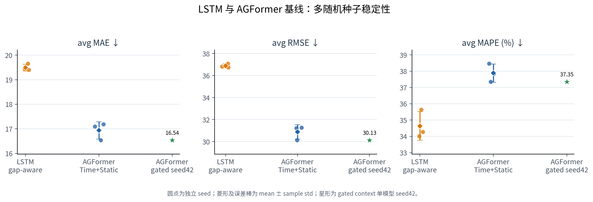
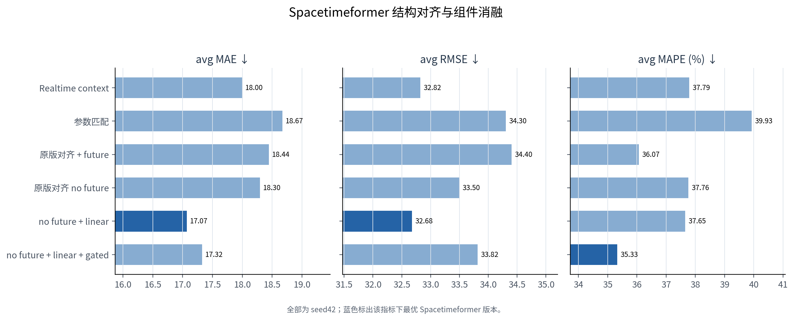
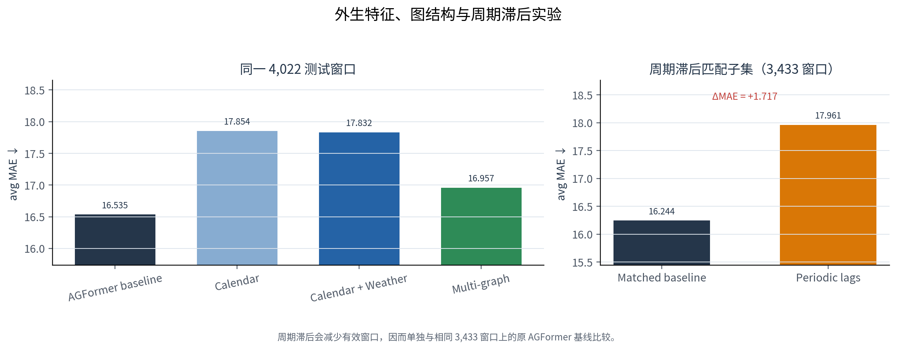
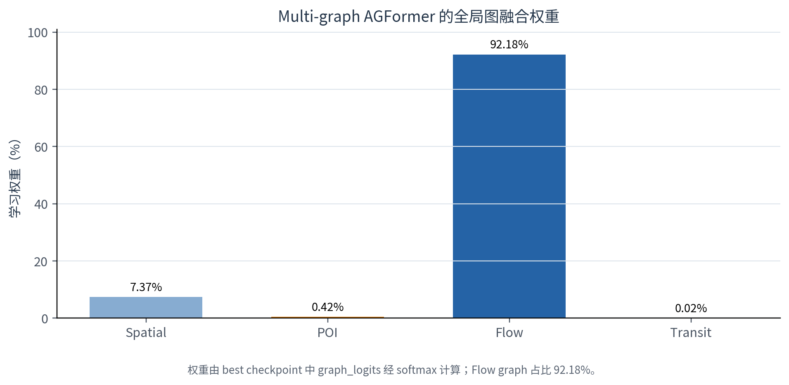
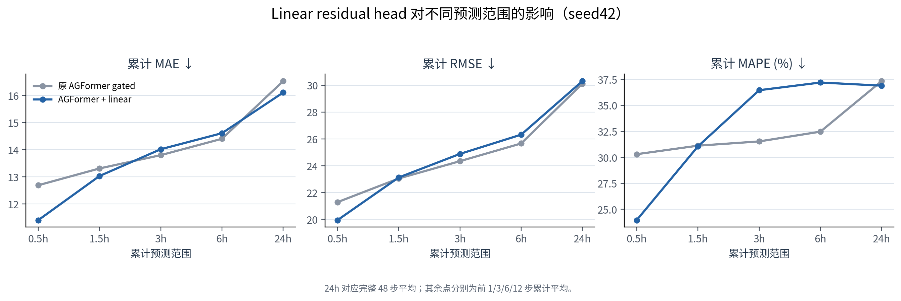
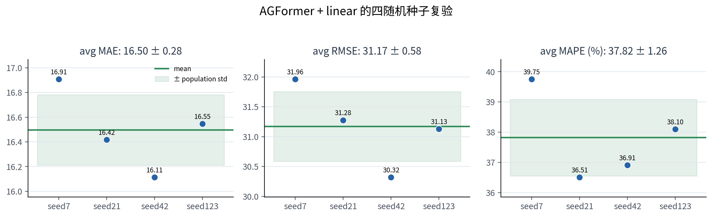
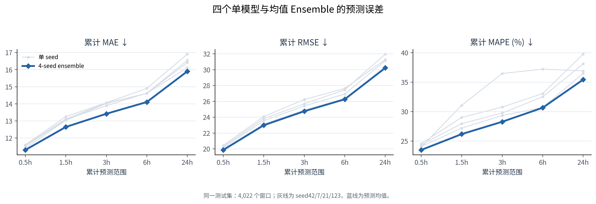
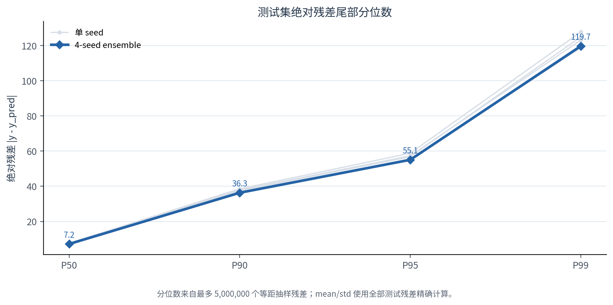
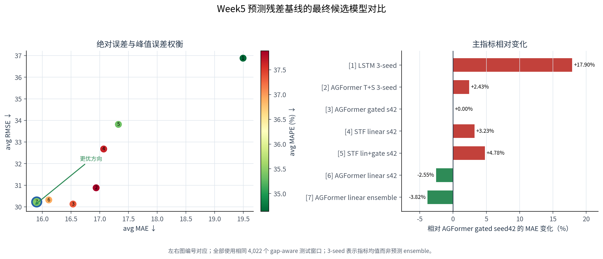

# Week 4 模型训练与预测基线选型报告

**项目名称**：基于多源时空数据融合的城市级人流异常检测与预警系统  
**报告日期**：2026-07-09  
**可视化与选型修订日期**：2026-08-09<br>
**报告阶段**：第四周 — 时空预测模型训练、消融实验与 Week5 异常检测基线选型

---

## 一、本周目标与结论概览

### 1.1 阶段目标

Week 4 的核心任务不是继续扩展数据工程，而是在已完成的数据修复、图结构构建、静态/时间/天气特征对齐基础上，系统训练和比较多个时空预测模型，选出最适合作为 Week 5 异常人流检测预测残差基线的模型。

Week 5 异常检测将主要依赖如下残差形式：

```text
raw_residual = |observed_flow - predicted_flow|
```

因此 Week 4 的主指标以 **MAE** 为核心，同时参考 RMSE 和 MAPE：

- **MAE**：衡量正常情况下平均预测偏差，直接影响异常残差底噪；
- **RMSE**：反映尖峰/大误差，对异常误报风险敏感；
- **MAPE**：反映低流量区域的相对误差，对低流量异常检测有参考价值。

### 1.2 最终推荐模型

本周最终推荐 Week 5 使用：

```text
AGFormer + gated context + linear residual head + 4-seed mean ensemble
```

对应结果：

| 模型 | avg MAE | avg RMSE | avg MAPE |
|------|--------:|---------:|---------:|
| 原 AGFormer best | 16.5350 | 30.1288 | 37.35 |
| AGFormer + linear seed42 | 16.1132 | 30.3198 | 36.91 |
| **AGFormer + linear 4-seed ensemble** | **15.9030** | **30.2250** | **35.44** |

相比 Week 4 前期最佳 AGFormer：

- MAE：16.5350 → **15.9030**，降低约 **3.82%**
- MAPE：37.35 → **35.44**，降低约 **5.11%**
- RMSE：30.1288 → 30.2250，基本持平，略高约 **0.32%**

该模型在 MAE 和 MAPE 上取得当前最佳综合表现，适合作为 Week 5 异常检测的主预测器。

---

## 二、实验设置

### 2.1 数据与任务设置

本周实验均基于 TaxiBJ 数据集：

| 配置项 | 设置 |
|--------|------|
| 城市 | Beijing / TaxiBJ |
| 空间网格 | 32 × 32，共 1024 节点 |
| 时间粒度 | 30 分钟 / 步 |
| 输入长度 | T_in = 48，即历史 24 小时 |
| 输出长度 | T_out = 48，即预测未来 24 小时 |
| 预测目标 | future inflow |
| 动态输入 | inflow + outflow + 时间编码 |
| 静态输入 | leakage-free static node features，33 维 |
| 划分方式 | 时间顺序切分 train / val / test |
| 间断窗口过滤 | 启用，窗口内必须连续 30 分钟 |

说明：报告中的 h1/h3/h6/h12 指标按代码实现为“前 h 个预测步的累计平均指标”，对应：

| 指标 | 时间范围 |
|------|----------|
| h1 | 未来 0.5 小时 |
| h3 | 未来 1.5 小时窗口 |
| h6 | 未来 3 小时窗口 |
| h12 | 未来 6 小时窗口 |

`avg` 为完整 48 步预测窗口的平均指标。

### 2.2 时间与静态特征规则

时间编码使用真实时间戳，而非简单序号推算：

```text
slot_sin / slot_cos
weekday_sin / weekday_cos
is_weekend
is_holiday
workday
```

静态节点特征原始为 41 维，但训练中排除了 8 维历史全数据流量统计特征，避免未来信息泄漏。因此实际输入静态特征为：

```text
static_dim = 33
```

### 2.3 训练配置

主要深度模型使用：

```text
optimizer = AdamW
loss      = HuberLoss
scheduler = ReduceLROnPlateau
patience  = 10
```

训练设备：

```text
NVIDIA GeForce RTX 5080 Laptop GPU
```

本周训练期间曾遇到 Windows 更新重启导致训练中断，以及 Codex sandbox 在 WSL2 下无法访问 `/dev/dxg` 的问题。已通过将 Codex sandbox mode 调整为 `danger-full-access` 修复，后续训练均确认 CUDA 可用。

---

## 三、模型训练主线

### 3.1 LSTM 与 AGFormer 基线

前期对照结果表明，gap-aware LSTM 是稳定基线，但 AGFormer 在 MAE/RMSE 上明显更强：

| 模型 | avg MAE | avg RMSE | avg MAPE | 说明 |
|------|--------:|---------:|---------:|------|
| LSTM gap-aware 3-seed avg | 19.4941 | 36.8806 | 34.64 | MAPE 较好，MAE/RMSE 较弱 |
| AGFormer Time+Static 3-seed avg | 16.9376 | 30.8805 | 37.88 | 明显优于 LSTM |
| AGFormer gated context seed42 | 16.5350 | 30.1288 | 37.35 | Week4 前期最佳单模型 |



<p class="figure-caption">图 3-1　LSTM 与 AGFormer 基线的多随机种子结果。圆点保留每个 seed 的真实取值，误差棒为样本标准差；gated context 目前只有 seed42，故不绘制误差棒。</p>

AGFormer 的优势主要来自：

1. 显式 spatial graph 先验；
2. adaptive adjacency；
3. temporal self-attention；
4. gated context 对时间/静态特征的稳定注入。

### 3.2 Spacetimeformer 系列探索

本周对 Spacetimeformer 做了多轮修正与对齐：

1. 修复真实时间戳输入；
2. 加入静态节点特征；
3. 参数匹配 AGFormer；
4. 将结构从 `chunk attention + global tokens` 改为更接近原论文的：
   - local temporal attention；
   - linear global spatiotemporal attention；
   - encoder-decoder target tokens；
   - given embedding；
   - value/time 分离 embedding；
   - decoder cross-attention；
5. 消融 future time、linear output、gated encoder context。

关键结果如下：

| 实验 | avg MAE | avg RMSE | avg MAPE | 结论 |
|------|--------:|---------:|---------:|------|
| Spacetimeformer realtime context | 17.9967 | 32.8214 | 37.79 | 修复真实时间后明显优于旧版 |
| 参数匹配版 | 18.6715 | 34.3047 | 39.93 | 加大模型未提升泛化 |
| 原版对齐 + future time | 18.4433 | 34.4038 | 36.07 | MAPE 改善，MAE/RMSE 不佳 |
| 原版对齐 no future time | 18.2950 | 33.4965 | 37.76 | 关闭 future time 改善 MAE/RMSE |
| no future + linear output | 17.0688 | 32.6759 | 37.65 | linear residual 明显有效 |
| no future + linear + gated | 17.3247 | 33.8161 | 35.33 | MAPE 改善，MAE/RMSE 变差 |



<p class="figure-caption">图 3-2　Spacetimeformer 系列的结构对齐与组件消融。各实验均为 seed42，颜色仅标出每项指标下的系列最优值，不代表多 seed 置信区间。</p>

结论：

- Spacetimeformer 经过原版式结构修正后仍未超过 AGFormer；
- 其最佳版本 MAE 接近 AGFormer 多 seed 平均，但未超过 AGFormer 单模型最佳；
- linear output 对 Spacetimeformer 非常有效，提示历史 inflow 的线性趋势/残差具有强预测价值；
- 对 TaxiBJ 这类 32×32 网格流量任务，显式空间图先验比纯 attention 学习空间关系更稳定。

### 3.3 多图、日历、天气与周期滞后实验

Week4 还测试了多类外生特征和图结构增强。

| 实验 | avg MAE | avg RMSE | avg MAPE | 结论 |
|------|--------:|---------:|---------:|------|
| Calendar context | 17.8542 | 32.3708 | 42.67 | 完善日历后 MAE 未改善 |
| Calendar + Weather | 17.8316 | 32.2941 | 40.97 | 天气仅有很小改善 |
| Multi-graph AGFormer | 16.9569 | 30.8844 | 37.81 | 多图全局融合未超过单图 |
| Periodic lags | 17.9614 | 33.2339 | 39.52 | 3,433 个匹配窗口；lag_48/lag_336/delta 组合无效 |



<p class="figure-caption">图 3-3　外生特征、图结构与周期滞后实验的 avg MAE。周期滞后会减少有效窗口，因此右图使用相同 3,433 个测试窗口上的原 AGFormer 基线（MAE 16.2443）作严格对照。</p>

多图实验中，模型学习到的图权重大致为：

```text
flow graph    ≈ 92.18%
spatial graph ≈  7.37%
poi graph     ≈  0.42%
transit graph ≈  0.02%
```



<p class="figure-caption">图 3-4　Multi-graph AGFormer 最优 checkpoint 的全局图融合权重。权重由 graph logits 经 softmax 计算，模型明显由 flow graph 主导。</p>

这说明当前简单全局图融合策略下，模型几乎退化为使用 flow graph，未能有效利用 POI/transit 结构。该方向后续若继续推进，应改为节点级/头级/层级动态图融合，而不是全局 softmax 融合。

---

## 四、AGFormer + Linear Residual Head

### 4.1 改动动机

Spacetimeformer 的 `use_linear_output: true` 带来了显著收益：

```text
Spacetimeformer no future:
avg MAE 18.2950 → 17.0688
```

因此将同样思想迁移至当前最强 AGFormer：

```text
prediction = AGFormer_output + Linear(history_inflow)
```

其中 `Linear(history_inflow)` 使用每个节点过去 48 步 inflow 直接映射到未来 48 步，负责捕捉强线性趋势；AGFormer 负责捕捉非线性时空残差。

### 4.2 单模型结果

| 模型 | avg MAE | avg RMSE | avg MAPE |
|------|--------:|---------:|---------:|
| AGFormer gated context seed42 | 16.5350 | 30.1288 | 37.35 |
| AGFormer + linear seed42 | 16.1132 | 30.3198 | 36.91 |

Horizon 结果：

| horizon | MAE | RMSE | MAPE |
|---------|----:|-----:|-----:|
| h1 | 11.4063 | 19.9477 | 23.96 |
| h3 | 13.0345 | 23.1312 | 31.06 |
| h6 | 14.0216 | 24.8885 | 36.47 |
| h12 | 14.6130 | 26.3245 | 37.21 |
| avg | 16.1132 | 30.3198 | 36.91 |



<p class="figure-caption">图 4-1　相同 seed42 下，原 AGFormer gated context 与加入 linear residual head 后的累计预测误差。横轴各点均为截至对应预测范围的累计平均，24h 为完整 48 步平均。</p>

结论：

- MAE 明显改善；
- MAPE 小幅改善；
- RMSE 基本持平，略高于原 AGFormer best；
- 对短期预测 h1/h3 改善尤其明显。

### 4.3 多随机种子复验

为验证改动稳定性，训练了 4 个随机种子：

| seed | avg MAE | avg RMSE | avg MAPE |
|------|--------:|---------:|---------:|
| 42 | 16.1132 | 30.3198 | 36.91 |
| 7 | 16.9079 | 31.9627 | 39.75 |
| 21 | 16.4172 | 31.2766 | 36.51 |
| 123 | 16.5463 | 31.1309 | 38.10 |

统计结果：

| 指标 | mean | std |
|------|-----:|----:|
| MAE | 16.4961 | 0.2850 |
| RMSE | 31.1725 | 0.5840 |
| MAPE | 37.8177 | 1.2623 |



<p class="figure-caption">图 4-2　AGFormer + linear 的四随机种子复验。散点展示 seed42/7/21/123 的 avg 指标，水平线和阴影分别表示均值与 mean ± population std。</p>

结论：

- seed42 是最优单模型；
- 4-seed 平均仍优于原 AGFormer best 的 16.5350；
- 说明 linear residual head 不是单 seed 偶然收益；
- 但不同 seed 波动仍存在，适合进一步做 ensemble。

---

## 五、多 seed Ensemble 评估

### 5.1 方法

使用 4 个 AGFormer + linear checkpoint：

```text
seed42
seed7
seed21
seed123
```

对同一测试集分别推理，然后取预测均值：

```text
ensemble_pred = mean(pred_seed42, pred_seed7, pred_seed21, pred_seed123)
```

该过程不重新训练，仅进行推理评估。

### 5.2 Ensemble 结果

| horizon | MAE | RMSE | MAPE |
|---------|----:|-----:|-----:|
| h1 | 11.3019 | 19.8621 | 23.49 |
| h3 | 12.6473 | 22.9856 | 26.18 |
| h6 | 13.4194 | 24.7530 | 28.28 |
| h12 | 14.1068 | 26.2676 | 30.66 |
| avg | **15.9030** | **30.2250** | **35.44** |

对比单模型：

| 模型 | avg MAE | avg RMSE | avg MAPE |
|------|--------:|---------:|---------:|
| AGFormer + linear seed42 | 16.1132 | 30.3198 | 36.91 |
| **AGFormer + linear 4-seed ensemble** | **15.9030** | **30.2250** | **35.44** |



<p class="figure-caption">图 5-1　同一 4,022 个测试窗口上，四个单 seed 模型与预测均值 Ensemble 的累计 horizon 指标。灰线为各成员，蓝线为 ensemble。</p>

结论：

- Ensemble 进一步降低 MAE；
- MAPE 明显改善；
- RMSE 与原 AGFormer best 接近；
- 对 Week5 异常检测而言，ensemble 能降低正常样本预测噪声，适合作为主预测器。

### 5.3 残差分布

4-seed ensemble 测试集绝对残差分布：

| 统计量 | abs residual |
|--------|-------------:|
| mean | 15.2119 |
| std | 25.3903 |
| p50 | 7.1749 |
| p90 | 36.3080 |
| p95 | 55.0564 |
| p99 | 119.7054 |



<p class="figure-caption">图 5-2　单模型与 Ensemble 的绝对残差尾部分位数。由于全测试残差规模很大，分位数按评估脚本使用最多 5,000,000 个等距样本估计；mean/std 使用全部残差计算。</p>

这些统计量可直接作为 Week5 异常检测阈值设计的起点。例如：

```text
score_raw = |y - y_hat|
threshold_global = p95 or p99
```

更推荐 Week5 使用分节点、分时段的残差标准化：

```text
score = |y - y_hat| / residual_scale[node, time_slot]
```

---

## 六、最终模型选择

### 6.1 同窗口最终候选对比

最终候选均采用真实时间编码、gap-aware 连续窗口过滤，并在同一 **4,022 个测试窗口**上评估。下表中的百分比表示 avg MAE 相对 `AGFormer gated context seed42` 的变化，负值代表改善。

| 模型 | 统计口径 | 单模型参数量 | avg MAE（相对基线） | avg RMSE | avg MAPE |
|------|----------|-------------:|---------------------:|---------:|---------:|
| LSTM gap-aware | 3-seed 指标均值 | 0.054 M | 19.4941（+17.90%） | 36.8806 | **34.64** |
| AGFormer Time+Static | 3-seed 指标均值 | 0.050 M | 16.9376（+2.43%） | 30.8805 | 37.88 |
| AGFormer gated context | seed42 | 0.050 M | 16.5350（基线） | **30.1288** | 37.35 |
| Spacetimeformer no future + linear | seed42 | 0.091 M | 17.0688（+3.23%） | 32.6759 | 37.65 |
| Spacetimeformer no future + linear + gated | seed42 | 0.095 M | 17.3247（+4.78%） | 33.8161 | 35.33 |
| AGFormer gated + linear | seed42 | 0.052 M | 16.1132（−2.55%） | 30.3198 | 36.91 |
| **AGFormer gated + linear ensemble** | **4-seed 预测均值** | **4 × 0.052 M** | **15.9030（−3.82%）** | 30.2250 | 35.44 |

其中“3-seed 指标均值”用于描述训练稳定性，并不等同于把三个模型的预测做 ensemble；只有最后一行执行了逐样本预测均值。



<p class="figure-caption">图 6-1　Week5 预测残差基线的最终候选模型对比。左图同时展示 MAE、RMSE 与 MAPE；右图以原 AGFormer gated seed42 为基线展示 MAE 相对变化。左下方向代表 MAE/RMSE 更优。</p>

该比较揭示了三个不能被单一指标掩盖的权衡：

1. **Ensemble 的 MAE 最低**，比原 AGFormer gated 降低 3.82%，最有利于压低正常时段的预测残差底噪；
2. **原 AGFormer gated 的 RMSE 仍最低**，ensemble 的 RMSE 高 0.0962，约 0.32%，因此 ensemble 并非在所有指标上绝对支配；
3. **LSTM 的 3-seed 平均 MAPE 最低**，Spacetimeformer gated 的 MAPE 也略低于 ensemble，但二者的 MAE/RMSE 明显更差。由于 Week5 以绝对预测残差为主要异常信号，不能仅凭 MAPE 选主模型。

### 6.2 精度、稳定性与部署成本

Linear residual head 的四个 seed 平均 MAE 为 `16.4961 ± 0.2850`；原 AGFormer Time+Static 的三个 seed 为 `16.9376 ± 0.3520`。这支持 linear head 的收益具有跨 seed 一致性，但两组 seed 集合及标准差口径并不完全相同，因此这里只作为稳定性证据，不作为严格配对显著性检验。

最终部署成本比较如下。推理次数是理论 forward-pass 数量，不是实测延迟；四模型可以串行执行以节省显存，也可以并行执行以降低墙钟时间。

| 方案 | 每批推理次数 | 总存储参数量 | avg MAE | 相对 AGFormer+linear seed42 | 适用场景 |
|------|-------------:|-------------:|--------:|----------------------------:|----------|
| AGFormer gated seed42 | 1 | 0.050 M | 16.5350 | +2.62% | 保留最低 RMSE 的审计基线 |
| Spacetimeformer + linear seed42 | 1 | 0.091 M | 17.0688 | +5.93% | 架构对照，不建议作为主部署模型 |
| **AGFormer + linear seed42** | **1** | **0.052 M** | **16.1132** | **基线** | 低延迟、低显存单模型部署 |
| **AGFormer + linear 4-seed ensemble** | **4** | **约 0.210 M** | **15.9030** | **−1.30%** | Week5 离线/批量异常检测主模型 |

相对最优单模型 seed42，ensemble 进一步改善：

- MAE：降低约 **1.30%**；
- RMSE：降低约 **0.31%**；
- MAPE：降低约 **3.99%**；
- 代价：需要保存并执行 4 个 checkpoint，理论计算量约为单模型的 4 倍。

### 6.3 Week5 主模型与降级方案

推荐主模型：

```text
AGFormer + gated context + linear residual head + 4-seed mean ensemble
```

推荐理由：

1. 当前所有实验中 avg MAE 最低；
2. MAPE 同时优于原 AGFormer；
3. 显式 spatial graph 适合 TaxiBJ 网格人流预测；
4. linear residual head 明显增强短期预测；
5. ensemble 可降低异常检测中的正常残差噪声；
6. 四个 checkpoint 已训练完成，可直接进入 Week5 残差生成。

若 Week6 API 的实时延迟或显存预算不允许四模型 ensemble，则采用 `AGFormer + linear seed42` 作为降级方案。它只需一次推理，MAE 仅比 ensemble 高 0.2102，同时仍优于原 AGFormer gated。

最终角色划分如下：

| 用途 | 模型 | 说明 |
|------|------|------|
| Week5 主预测残差 | AGFormer + linear 4-seed ensemble | MAE 最低，优先保证异常残差底噪 |
| 实时/资源受限降级 | AGFormer + linear seed42 | 单模型 MAE 最优，只需一次推理 |
| RMSE 审计参考 | 原 AGFormer gated seed42 | RMSE 最低，用于检查尖峰误差权衡 |
| 相对误差参考 | Spacetimeformer linear + gated | MAPE 35.33，但 MAE/RMSE 不适合作主模型 |
| 传统深度基线 | LSTM gap-aware | 3-seed 平均 MAPE 最低，但绝对误差明显偏高 |

---

## 七、工程产物

### 7.1 新增/修改模型代码

| 文件 | 内容 |
|------|------|
| `src/models/agformer.py` | 新增 `use_linear_output`，支持 AGFormer 输出叠加线性残差头 |
| `src/models/spacetimeformer.py` | 重构为更接近原版 Spacetimeformer 的 encoder-decoder/local-global attention 结构 |
| `scripts/train.py` | 支持 AGFormer/Spacetimeformer 新配置字段 |
| `scripts/evaluate_agformer_linear_ensemble.py` | 新增多 seed ensemble 评估脚本 |
| `scripts/generate_week4_report.py` | 从保留的实验结果生成第 3–5 章图表，并重建 HTML/PDF 报告 |

### 7.2 关键配置文件

| 配置 | 说明 |
|------|------|
| `configs/agformer_gate_context_linear_seed42.yaml` | 最优单模型 seed42 |
| `configs/agformer_gate_context_linear_seed7.yaml` | 多 seed 复验 |
| `configs/agformer_gate_context_linear_seed21.yaml` | 多 seed 复验 |
| `configs/agformer_gate_context_linear_seed123.yaml` | 多 seed 复验 |
| `configs/spacetimeformer_original_aligned_seed42.yaml` | 原版对齐 Spacetimeformer |
| `configs/spacetimeformer_original_aligned_no_future_time_linear_seed42.yaml` | 最优 Spacetimeformer 消融 |

### 7.3 关键结果文件

| 文件 | 内容 |
|------|------|
| `outputs/results/week3_metrics.csv` | 所有训练结果汇总 |
| `outputs/results/agformer_gate_context_linear_ensemble_4seed.json` | ensemble 评估与残差统计 |
| `outputs/results/agformer_multigraph_weights.json` | 多图 checkpoint 的 graph logits 与 softmax 权重快照 |
| `outputs/checkpoints/agformer_gate_context_linear_seed42/best.pt` | 最优单模型 checkpoint |
| `outputs/checkpoints/agformer_gate_context_linear_seed7/best.pt` | ensemble 成员 |
| `outputs/checkpoints/agformer_gate_context_linear_seed21/best.pt` | ensemble 成员 |
| `outputs/checkpoints/agformer_gate_context_linear_seed123/best.pt` | ensemble 成员 |

---

## 八、经验总结与失败分析

### 8.1 Spacetimeformer 未超过 AGFormer 的原因

虽然理论上 Spacetimeformer 具有更通用的全局时空建模能力，但在本项目中未超过 AGFormer。主要原因包括：

1. TaxiBJ 是规则网格流量任务，局部空间邻接关系非常强；
2. AGFormer 显式使用 spatial graph，提供了强先验；
3. Spacetimeformer 需要从数据中自行学习空间关系，在 1024 节点规模下更难；
4. 当前训练样本数量不足以充分发挥大规模全局 attention 的优势；
5. 实验显示 linear residual 对所有模型都非常重要，说明强线性趋势本身已解释大量预测信号。

### 8.2 多图融合未提升的原因

当前多图实验采用全局可学习图权重，最终几乎被 flow graph 主导。该机制过于粗粒度，无法根据节点、时间或注意力头动态选择图结构，因此未能充分利用 POI/transit 语义图。

后续若继续做多图，应考虑：

```text
node-wise graph gating
head-wise graph attention
layer-wise graph fusion
time-conditioned graph mixing
```

### 8.3 Future time 的影响

Spacetimeformer 中加入 decoder future time 后：

- MAPE 改善；
- MAE/RMSE 变差。

说明未来时间特征可能帮助低流量相对误差，但会引入额外噪声，影响绝对误差。Week5 主线不建议依赖 future time decoder。

---

## 九、Week5 交接建议

### 9.1 预测残差生成

Week5 建议直接使用 4-seed ensemble 生成预测：

```text
members:
- agformer_gate_context_linear_seed42
- agformer_gate_context_linear_seed7
- agformer_gate_context_linear_seed21
- agformer_gate_context_linear_seed123

prediction = mean(member_predictions)
residual = |observed - prediction|
```

### 9.2 异常分数建议

第一版异常分数：

```text
score_raw = |y - y_hat|
```

更推荐的标准化异常分数：

```text
score_norm = |y - y_hat| / (residual_scale[node, slot] + eps)
```

其中 `residual_scale[node, slot]` 可由验证集或训练集滚动预测残差估计，按节点和日内 48 个 slot 分组。

### 9.3 阈值策略

可从以下阈值开始：

| 阈值 | 用途 |
|------|------|
| residual p95 | 高召回预警 |
| residual p99 | 高精度预警 |
| node-slot p95 | 分区域分时段自适应预警 |
| EWMA residual | 连续异常检测 |

### 9.4 Week5 推荐任务顺序

1. 使用 ensemble 在 test/validation 上生成预测与残差；
2. 计算 global / per-node / per-slot 残差分布；
3. 实现 raw residual 与 normalized residual 两种 anomaly score；
4. 构造无监督异常阈值；
5. 若有异常标签，评估 precision / recall / F1；
6. 做可视化：异常区域热力图、时间序列残差图、Top-K 异常事件列表。

---

## 十、本周结论

Week4 完成了从模型训练、特征消融、结构改造到多 seed ensemble 的完整实验链路。核心结论如下：

1. **AGFormer 仍是本项目最适合的主模型**，显式空间图先验对 TaxiBJ 网格流量预测非常有效；
2. **linear residual head 是本周最有效的结构改动**，显著提升 AGFormer 与 Spacetimeformer；
3. **Spacetimeformer 经原版式对齐后仍未超过 AGFormer**，说明在本任务中显式图先验优于纯全局 attention；
4. **多 seed ensemble 进一步刷新最佳 MAE/MAPE**，是 Week5 异常检测的推荐预测基线；
5. Week5 应从“继续训练模型”转向“基于最优预测器构造残差异常分数与阈值体系”。

最终推荐：

```text
Week5 主预测器 = AGFormer + gated context + linear residual head + 4-seed mean ensemble
```

最终指标：

```text
avg MAE  = 15.9030
avg RMSE = 30.2250
avg MAPE = 35.44
```
