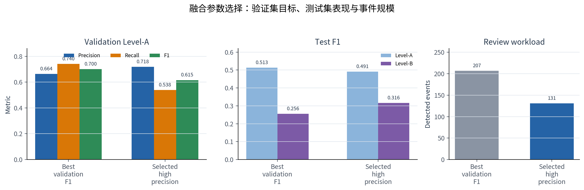
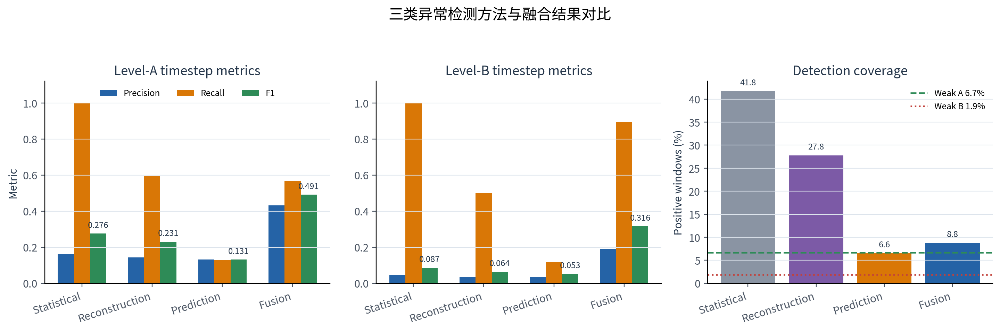
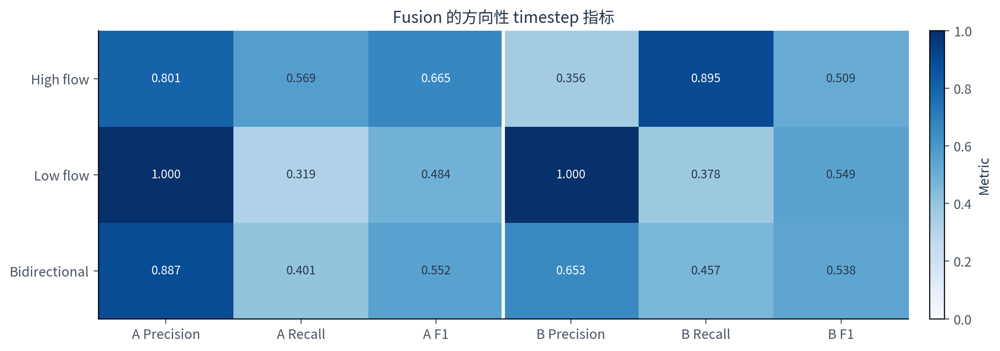
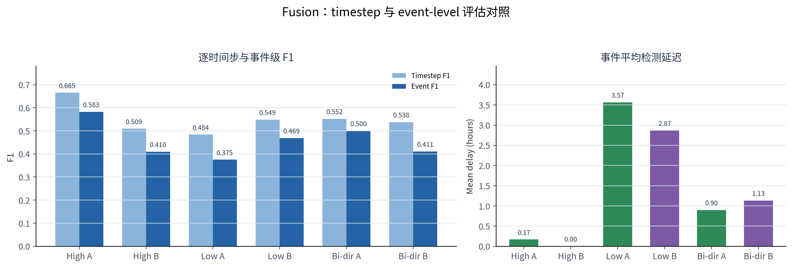
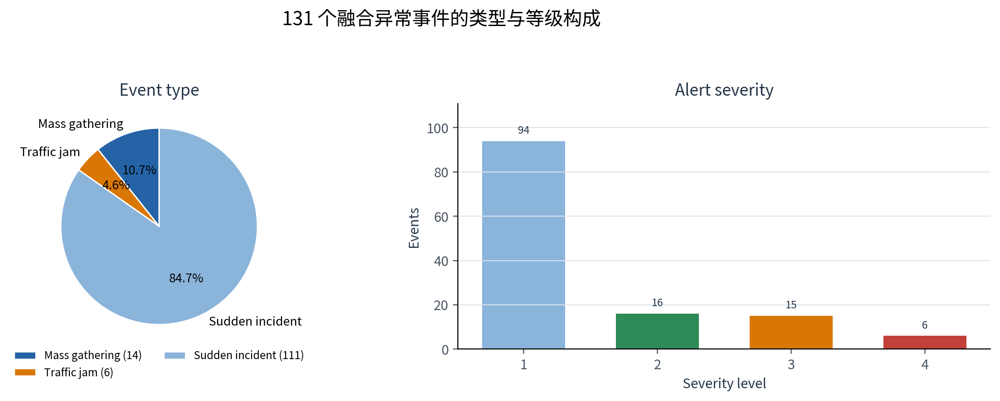
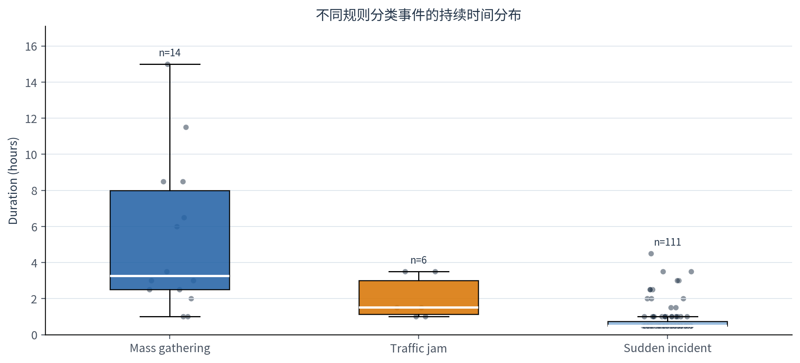
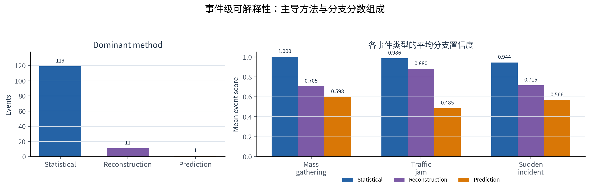
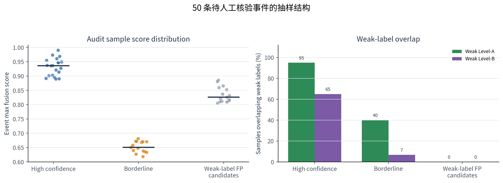

# Week 5 异常检测模型实现与融合评估报告

**项目名称**：基于多源时空数据融合的城市级人流异常检测与预警系统  
**报告日期**：2026-08-04  
**报告阶段**：第五周 — 异常检测方法实现、多模型融合、事件分类与人工核验样本生成

---

## 一、本周目标与结论概览

### 1.1 阶段目标

Week 5 的核心目标是在 Week 4 已选出的最佳预测模型基础上，实现城市网格人流异常检测模块。根据项目要求，本周需要覆盖三类异常检测方法，并最终形成加权投票融合框架：

1. **基于统计规则的异常检测**：实现 3σ 原则和 IQR 方法，基于历史人流数据计算每个网格在每个时间槽的正常波动范围；
2. **基于重构误差的异常检测**：实现 VAE 和 Transformer AutoEncoder，学习正常人流模式，通过重构误差识别异常；
3. **基于预测误差的异常检测**：使用 Week 4 最优 AGFormer 预测模型，计算预测值和真实值之间的残差；
4. **多模型融合与事件分类**：设计加权投票策略，并将异常事件分类为大型集会、交通拥堵、突发事件。

由于 TaxiBJ 数据集没有人工真值标签，本报告使用统计规则生成的弱标签作为评估锚点，并额外输出人工抽样核验表，用于后续 sanity check。

### 1.2 最终结论

当前推荐 Week 5 主结果使用如下融合配置：

```text
statistical weight      = 0.70
reconstruction weight   = 0.20
prediction weight       = 0.10
decision threshold      = 0.56
minimum event cells     = 6
```

最终融合模型在 TaxiBJ test 的 4,022 个预测窗口上得到：

| 评估口径 | Precision | Recall | F1 |
|----------|----------:|-------:|---:|
| Level-A timestep | 0.4322 | 0.5688 | 0.4912 |
| Level-B timestep | 0.1921 | 0.8947 | 0.3163 |
| High-flow Level-A timestep | 0.8010 | 0.5688 | 0.6652 |
| High-flow Level-B timestep | 0.3560 | 0.8947 | 0.5094 |
| High-flow Level-A event | 0.6316 | 0.5405 | 0.5825 |
| High-flow Level-B event | 0.2632 | 0.9259 | 0.4098 |

最终输出 131 个融合异常事件：

| 事件类型 | 数量 |
|----------|----:|
| mass_gathering | 14 |
| traffic_jam | 6 |
| sudden_incident | 111 |
| **Total** | **131** |

本周最重要的工程结果是：异常检测模块已经从“单纯 timestep F1 评估”推进到“方向拆分 + 事件级评估 + 可解释事件表 + 人工核验样本”的可交付形态。

---

## 二、数据、任务与弱标签设置

### 2.1 数据与窗口设置

本周实验基于 TaxiBJ：

| 配置项 | 设置 |
|--------|------|
| 城市 | Beijing / TaxiBJ |
| 空间网格 | 32 × 32，共 1024 个节点 |
| 时间粒度 | 30 分钟 / step |
| 动态流量 | inflow + outflow |
| 预测模型输入长度 | T_in = 48，即历史 24 小时 |
| 预测模型输出长度 | T_out = 48，即未来 24 小时 |
| 异常检测预测 horizon | h1，即未来第 1 个 30 分钟窗口 |
| 测试窗口数 | 4,022 |
| Week 4 预测基线 | AGFormer + gated context + linear residual head + 4-seed ensemble |

### 2.2 弱标签规则

TaxiBJ 没有人工异常标签，因此使用弱标签评估检测器。当前实现保留两级弱标签：

**Level-A：高流量统计异常**

```text
inflow z-score > 3.0 的网格数 >= 12
```

**Level-B：高可信同步异常**

```text
inflow z-score > 3.0 的网格数 >= 12
AND
outflow z-score > 3.0 的网格数 >= 25
```

Level-B 是 Level-A 的更严格版本，用于构造更高可信但更稀疏的评估锚点。outflow 的均值和方差单独在训练集 outflow 上拟合，不再复用 inflow 的统计量。

当前 test 窗口的弱标签正例率：

| 标签方向 | Level-A | Level-B |
|----------|--------:|--------:|
| high | 6.69% | 1.89% |
| low | 12.46% | 10.52% |
| bidirectional | 19.47% | 12.56% |

说明：主报告口径仍以 high-flow 异常为核心；low 和 bidirectional 是为解释检测器双向异常能力而新增的评估视角。

---

## 三、三类异常检测方法实现

### 3.1 统计规则检测：3σ + IQR

统计检测在训练集上为每个网格、每个日内时间槽拟合历史正常范围：

```text
slot = local_time_of_day / 30min
mean, std, q1, q3, IQR are fitted per (slot, grid)
```

检测分数由两部分组成：

1. **3σ score**：当前流量相对该网格该时槽历史均值的 z-score；
2. **IQR score**：当前流量是否越过 `Q1 - 1.5 IQR` 或 `Q3 + 1.5 IQR`。

统计分数归一化后用于融合。统计方法覆盖率高、召回强，但假阳性较多；这符合它作为弱标签和基础检测器的定位。

### 3.2 重构误差检测：VAE + Transformer AutoEncoder

重构检测包含两个模型：

| 模型 | 输入 | 训练目标 |
|------|------|----------|
| VAE | 单个 1024 维 inflow 网格向量 | 重构当前网格流量 |
| Transformer AE | 长度 12 的 inflow 序列窗口 | 重构序列中每个 timestep |

本周对重构检测做了关键修正：**VAE 和 Transformer AE 都只使用 weak-normal 数据训练**。

具体规则：

```text
VAE:
  train timestep is used only if Level-B weak label = 0

Transformer AE:
  train sequence is used only if all timesteps in the 12-step window have Level-B weak label = 0
```

最终训练统计：

| 项目 | 数值 |
|------|----:|
| train timesteps | 15,738 |
| train Level-B weak positives | 199 |
| VAE weak-normal vectors | 15,539 |
| Transformer AE weak-normal windows | 14,933 |
| VAE best validation loss | 0.1605 |
| Transformer AE best validation loss | 0.1106 |

这样做的目的不是让 AutoEncoder 学会所有模式，而是让它更像“正常模式重构器”：异常窗口不应被轻易重构，从而提高重构误差的辨识度。

### 3.3 预测误差检测：AGFormer 残差

预测误差检测复用 Week 4 最优模型：

```text
AGFormer + gated context + linear residual head + 4-seed mean ensemble
```

使用的 checkpoint tags：

```text
agformer_gate_context_linear_seed42
agformer_gate_context_linear_seed7
agformer_gate_context_linear_seed21
agformer_gate_context_linear_seed123
```

预测误差定义为：

```text
prediction_residual = |observed_inflow - predicted_inflow|
```

预测误差方法的覆盖率较低，但它能捕捉“统计范围内但模型预测失败”的异常，是融合框架中的补充信号。

---

## 四、多模型融合策略

### 4.1 置信度归一化

三类方法原始分数量纲不同，因此统一映射到 0–1 置信度：

```text
confidence = clip(score / (2 * threshold), 0, 1)
```

其中 threshold 由 validation 分位数或统计规则阈值确定。融合分数为：

```text
fusion_score =
    w_statistical    * statistical_confidence
  + w_reconstruction * reconstruction_confidence
  + w_prediction     * prediction_confidence
```

当 `fusion_score >= decision_threshold` 且异常网格数不少于 6 时，判定该 timestep 存在异常。

### 4.2 融合参数选择

融合参数在 validation weak labels 上选择，然后固定到 test 上评估。调参结果如下：

| 方案 | 权重 stat/recon/pred | 阈值 | Test Level-A F1 | Test Level-B F1 | 事件数 | 说明 |
|------|----------------------|-----:|-----------:|-----------:|------:|------|
| best_f1_unconstrained | 0.60 / 0.20 / 0.20 | 0.51 | 0.5134 | 0.2558 | 207 | Level-A F1 最高，但 Level-B 精度更弱、事件偏多 |
| high_precision_ge_0_70 | 0.70 / 0.20 / 0.10 | 0.56 | 0.4912 | 0.3163 | 131 | 更适合报告与后续人工核验 |



<p class="figure-caption">图 4-1　两套候选融合方案在 validation Level-A、test Level-A/Level-B 和事件数量上的对比。参数只在 validation 弱标签上选择；test 指标用于固定参数后的评估，不参与调参。</p>

最终选择 high-precision 方案。原因是 Week5 的目标不是最大化弱标签 F1，而是输出可解释、可核验、事件数量可控的异常检测结果。该方案牺牲少量 Level-A F1，换来：

1. 更高 Level-B F1；
2. 更少事件数，降低人工核验负担；
3. traffic_jam 分类不再为 0；
4. 输出更适合作为 Week5 交付基线。

---

## 五、检测结果与评估

### 5.1 各方法 timestep 评估

| 方法 | Level-A Precision | Level-A Recall | Level-A F1 | Level-B Precision | Level-B Recall | Level-B F1 |
|------|------------------:|---------------:|-----------:|------------------:|---------------:|-----------:|
| statistical | 0.1601 | 1.0000 | 0.2760 | 0.0452 | 1.0000 | 0.0866 |
| reconstruction | 0.1431 | 0.5948 | 0.2307 | 0.0340 | 0.5000 | 0.0637 |
| prediction | 0.1326 | 0.1301 | 0.1313 | 0.0341 | 0.1184 | 0.0529 |
| **fusion** | **0.4322** | **0.5688** | **0.4912** | **0.1921** | **0.8947** | **0.3163** |



<p class="figure-caption">图 5-1　统计、重构、预测误差与融合方法的 timestep 指标及检测覆盖率。F1 数值标在对应柱上；右图虚线为 Level-A/Level-B 弱标签正例率。</p>

融合后的结果明显优于任一单方法。统计方法本身召回为 1.0，但 positive rate 高达 41.77%，无法直接作为最终检测结果；融合策略将 positive rate 压到 8.80%，同时保留较高 Level-B 召回。

### 5.2 high / low / bidirectional 方向拆分

早期只看 high-flow 弱标签时，部分低流量异常会被当作 false positive。为解释这一问题，本周新增方向拆分评估。

融合方法在三种方向下的 timestep 结果：

| 方向 | 标签 | Precision | Recall | F1 |
|------|------|----------:|-------:|---:|
| high | Level-A | 0.8010 | 0.5688 | 0.6652 |
| high | Level-B | 0.3560 | 0.8947 | 0.5094 |
| low | Level-A | 1.0000 | 0.3194 | 0.4841 |
| low | Level-B | 1.0000 | 0.3783 | 0.5489 |
| bidirectional | Level-A | 0.8870 | 0.4010 | 0.5523 |
| bidirectional | Level-B | 0.6525 | 0.4574 | 0.5378 |



<p class="figure-caption">图 5-2　最终 fusion 在 high、low 和 bidirectional 三种方向下的 Precision、Recall 与 F1。Level-A 和 Level-B 分区展示，便于识别高召回与高精度口径的差异。</p>

结论：

- 原始 Level-A timestep F1 为 0.4912，但 high-flow 拆分后 F1 提升到 0.6652；
- low-flow 检测的 precision 很高，但 recall 较低，说明融合结果中确实存在低流量异常信号；
- bidirectional 评估更符合实际检测器行为，因为统计、重构和预测残差都可能响应双向异常。

需要注意：方向拆分使用的是观测 inflow 的 slot-normalized z-score sign，不代表模型直接预测了 high/low 方向。

### 5.3 事件级评估

timestep F1 要求每个 30 分钟窗口逐点对齐，但异常检测更关心“事件是否被命中”。因此本周新增 event-level evaluation：先将连续 anomalous timesteps 合并为事件，再按时间重叠进行匹配。

融合方法事件级结果：

| 方向 | 标签 | Event Precision | Event Recall | Event F1 | Mean Delay |
|------|------|----------------:|-------------:|---------:|-----------:|
| high | Level-A | 0.6316 | 0.5405 | 0.5825 | 0.17h |
| high | Level-B | 0.2632 | 0.9259 | 0.4098 | 0.00h |
| low | Level-A | 0.5172 | 0.2941 | 0.3750 | 3.57h |
| low | Level-B | 0.5172 | 0.4286 | 0.4688 | 2.87h |
| bidirectional | Level-A | 0.5854 | 0.4364 | 0.5000 | 0.90h |
| bidirectional | Level-B | 0.3089 | 0.6129 | 0.4108 | 1.13h |



<p class="figure-caption">图 5-3　同一 fusion 输出在 timestep 与 event-level 口径下的 F1，以及事件首次命中的平均延迟。延迟只针对成功匹配的弱标签参考事件计算。</p>

事件级结果说明：

1. high Level-A event F1 为 0.5825，略低于 high timestep F1，但更贴近真实异常检测任务；
2. high Level-B event recall 达到 0.9259，说明高可信事件大多能被 fusion 捕捉；
3. low-flow event 的 delay 较大，说明低流量异常常以持续低迷形式出现，模型往往在事件中后段才触发。

---

## 六、事件合并与异常分类

### 6.1 空间连续事件合并

早期事件合并只看时间连续性：只要相邻 timestep 都异常，就合成同一个事件。这会把不同地点但时间相邻的异常误合并。

当前实现加入空间连续性约束：

```text
两个相邻 timestep 合并为同一事件，当且仅当：

time is continuous
AND
(
    spatial IoU >= 0.05
    OR centroid distance <= 4.0 grid cells
)
```

这样可以避免一个区域的异常结束后，另一个区域的异常刚好开始时被错误合成单个长事件。

### 6.2 异常分类规则

当前事件分类支持三类：

| 类别 | 语义 | 规则特征 |
|------|------|----------|
| mass_gathering | 大型集会 / 区域集中人流 | 大面积集中、持续、inflow/outflow 相对均衡 |
| traffic_jam | 交通拥堵 / 带状道路异常 | 形态带状、道路密度较高、持续时间较长 |
| sudden_incident | 突发事件 | 短时、小范围、多点或不稳定 |

本周新增的分类特征：

```text
aspect_ratio
road_density
in_out_imbalance
duration_trend
cluster_count
```

最终分类数量：

| 类别 | 数量 | 占比 |
|------|----:|----:|
| mass_gathering | 14 | 10.7% |
| traffic_jam | 6 | 4.6% |
| sudden_incident | 111 | 84.7% |



<p class="figure-caption">图 6-1　131 个融合异常事件的规则分类与 severity 分布。事件类型和等级都是算法输出，并非人工真值标签。</p>



<p class="figure-caption">图 6-2　各规则分类事件的持续时间箱线图与真实样本点。mass_gathering 的持续时间整体更长；traffic_jam 仅有 6 个样本，应谨慎解读其分布。</p>

相比早期版本，`traffic_jam` 不再全部为 0，说明分类规则已经能识别一部分带状、道路相关、持续性异常。不过当前 road_density 仍来自静态 node feature 的代理变量，后续如果需要更强交通拥堵识别，应接入真实路网线段或更精细的道路类型特征。

---

## 七、可解释性输出与人工核验

### 7.1 事件解释表

本周新增：

```text
outputs/week5_anomaly/event_explainability.csv
```

每个事件包含以下解释字段：

| 字段 | 含义 |
|------|------|
| statistical_score | 统计规则贡献 |
| reconstruction_score | 重构误差贡献 |
| prediction_score | 预测残差贡献 |
| dominant_method | 主导该事件的检测方法 |
| top_cells | 贡献最高的 top grid cells |
| max_z | 最大统计 z-score |
| max_reconstruction_error | 最大原始重构误差 |
| max_prediction_residual | 最大预测残差 |
| road_density_mean | 事件区域平均道路密度 |
| in_out_imbalance | inflow/outflow 不平衡程度 |
| duration_trend_slope | 事件期间流量趋势 |



<p class="figure-caption">图 7-1　左图为原始分支置信度最高的方法，右图为不同规则分类事件的平均 0–1 分支置信度（未乘融合权重）。119/131 个事件由 statistical score 主导，说明重构与预测分支目前主要提供互补证据。</p>

该表可用于回答 mentor 可能提出的问题：为什么这个事件被判为异常、由哪个方法主导、发生在哪些网格、流量和统计偏离有多大。

### 7.2 人工抽样核验表

由于没有真标签，本周新增人工核验样本：

```text
outputs/week5_anomaly/audit/event_audit_sample_50.csv
```

抽样组成：

| 样本组 | 数量 | 含义 |
|--------|----:|------|
| high_confidence | 20 | fusion score 最高的事件 |
| borderline | 15 | fusion score 接近决策阈值的边界事件 |
| false_positive_by_weak_label | 15 | fusion 检出但 high Level-A 弱标签未标出的候选事件 |



<p class="figure-caption">图 7-2　50 条待人工核验事件的 fusion 分数和弱标签重合率。weak-label false-positive candidates 的弱标签重合率按定义为 0，不等于人工确认的假阳性。</p>

注意：`false_positive_by_weak_label` 并不是人工确认的假阳性，只是 weak-label false-positive candidates。后续人工核验后，可以把结果填回 `manual_is_real_anomaly`、`manual_event_class`、`manual_notes` 三列，用于估计弱标签噪声和修正报告结论。

---

## 八、评估边界与局限性

当前实验完成了弱监督条件下的相对比较，但在解释指标时必须保留以下边界：

1. **没有人工异常真值**：TaxiBJ 不提供异常事件标签，因此报告中的 Precision、Recall 和 F1 衡量的是检测结果与统计弱标签的一致性，不能直接等价为真实世界异常检测准确率。
2. **两级标签并非独立任务**：Level-B 是 Level-A 的更严格子集，用于观察高可信同步异常；两套结果不能当作两个相互独立的数据集进行比较。
3. **统计方法与弱标签存在同源性**：弱标签和 statistical detector 都依赖 slot-normalized z-score 等统计规则，因此 statistical recall = 1.0 部分来自定义上的结构性优势。融合权重选择也可能因此偏向统计分支。
4. **方向拆分依赖观测值**：high/low 使用真实 inflow 相对历史基线的 z-score sign 划分，只用于评估解释，不代表模型在检测时独立预测了异常方向。
5. **事件匹配以时间为主**：事件构建阶段已经加入空间 IoU 和质心距离约束，但当前 event-level 指标主要按时间重叠匹配，尚未要求预测事件与弱标签事件在空间上同时匹配。
6. **事件分类尚无类别真值**：mass_gathering、traffic_jam 和 sudden_incident 由规则特征推断。14/6/111 是模型输出分布，而不是分类准确率；尤其 traffic_jam 样本只有 6 个，不能据此证明该类别已经稳定识别。
7. **人工核验尚未完成**：当前只生成了 50 条分层抽样队列，`manual_is_real_anomaly`、`manual_event_class` 和 `manual_notes` 尚未填写。因此本报告没有人工一致率，也不能把 weak-label false-positive candidates 称为真实假阳性。
8. **融合仍由统计分支主导**：131 个最终事件中有 119 个的 dominant method 为 statistical，重构与预测误差主要起补充和过滤作用。这说明当前方案是统计规则主导的融合基线，而不是三个分支贡献均衡的集成模型。

在上述限制下，本报告最可靠的结论是：融合方法相较单一检测器能显著压缩候选事件规模，并在固定弱标签口径下改善综合 F1；真实异常有效性与事件分类质量仍需人工核验或外部事件数据验证。

---

## 九、可复现性与 checkpoint 校验

### 9.1 关键配置与命令

主配置：

```text
configs/week5_anomaly.yaml
```

正式重跑命令：

```bash
.venv/bin/python -u scripts/run_week5_anomaly_detection.py \
  --config configs/week5_anomaly.yaml \
  --force-train \
  --device cuda
```

融合调参命令：

```bash
.venv/bin/python scripts/tune_week5_fusion.py \
  --scores outputs/week5_anomaly/scores.npz \
  --config outputs/week5_anomaly/config_used.yaml \
  --output-dir outputs/week5_anomaly/tuned_fusion \
  --min-cells 6 \
  --grid-shape 32,32
```

最终主输出重跑命令：

```bash
.venv/bin/python -u scripts/run_week5_anomaly_detection.py \
  --config configs/week5_anomaly.yaml \
  --device cuda
```

方向与事件级评估命令：

```bash
.venv/bin/python scripts/evaluate_week5_anomaly_metrics.py \
  --scores outputs/week5_anomaly/scores.npz \
  --config outputs/week5_anomaly/config_used.yaml \
  --output-dir outputs/week5_anomaly/evaluation \
  --event-tolerance-steps 1
```

人工核验样本生成命令：

```bash
.venv/bin/python scripts/sample_week5_anomaly_events.py \
  --events outputs/week5_anomaly/events.csv \
  --scores outputs/week5_anomaly/scores.npz \
  --summary outputs/week5_anomaly/summary.json \
  --output-dir outputs/week5_anomaly/audit
```

### 9.2 Reconstruction checkpoint 校验

当前 VAE 和 Transformer AE checkpoint 保存并校验以下元数据：

```text
city
data_path
data_shape
split_info
input_dim
scaler_mean_hash
scaler_std_hash
train_in_hash
label_rule_params
label_rule_hash
train_weak_label_positive_count
model hyperparams
weak_normal_vector_count / weak_normal_window_count
```

如果以上字段与当前配置不一致，脚本会拒绝直接加载旧 checkpoint 并重新训练。这可以防止改了 label 规则、split、scaler 或模型超参后误用旧模型。

限制：这不是完整 provenance。如果预处理代码变化但数据文件内容和训练输入 hash 不变，checkpoint 不一定自动失效。后续可以进一步加入 git commit hash 或 preprocessing code hash。

### 9.3 Reviewer 复审

本轮实现后已调用 `training_reviewer` 做只读复审，结论为：

```text
BLOCKER: 无
HIGH:    无
MEDIUM:  3
LOW:     3
```

需要在报告中保留的 caveats：

1. 事件空间合并仍可能对多中心事件产生拆分或误合并；
2. weak-label false-positive candidates 不等于人工确认假阳性；
3. checkpoint metadata 已覆盖关键配置，但不是完整 provenance；
4. high/low 方向拆分使用观测 z-score sign，不代表模型直接预测方向；
5. 当前 `duration_hours = steps * 0.5` 适配 TaxiBJ，跨数据集时需要配置化。

---

## 十、主要输出文件

| 文件 | 用途 |
|------|------|
| `outputs/week5_anomaly/summary.json` | Week5 主结果汇总 |
| `outputs/week5_anomaly/scores.npz` | 三类方法分数、mask、weak labels、预测残差 |
| `outputs/week5_anomaly/events.csv` | 融合后异常事件表 |
| `outputs/week5_anomaly/event_explainability.csv` | 事件级可解释性表 |
| `outputs/week5_anomaly/audit/event_audit_sample_50.csv` | 50 个事件人工核验样本 |
| `outputs/week5_anomaly/evaluation/directional_timestep_metrics.csv` | high/low/bidirectional timestep 指标 |
| `outputs/week5_anomaly/evaluation/event_level_metrics.csv` | event-level 指标 |
| `outputs/week5_anomaly/evaluation/directional_event_summary.json` | 方向与事件评估汇总 |
| `outputs/week5_anomaly/tuned_fusion/fusion_tuning_summary.json` | 融合权重和阈值调参结果 |

---

## 十一、结论与下一步

Week 5 已完成项目 PDF 中要求的三类异常检测方法和融合框架：

1. 统计规则：3σ + IQR；
2. 重构误差：VAE + Transformer AE；
3. 预测误差：AGFormer 4-seed ensemble residual；
4. 多模型融合：weighted voting；
5. 异常分类：mass_gathering / traffic_jam / sudden_incident；
6. 事件级输出：空间连续合并、解释字段、人工核验样本。

当前结果可以作为 Week5 异常检测 baseline 提交。下一步建议优先做人工核验：

1. 打开 `event_audit_sample_50.csv`；
2. 对每个事件填写是否真实异常、人工类别和备注；
3. 统计人工一致率；
4. 如果 weak-label false-positive candidates 中有大量真实异常，应在报告中明确说明当前弱标签低估了检测器质量；
5. 如果很多 high-confidence 事件被人工判为非异常，则需要进一步提高融合阈值或增加空间/时间稳定性约束。

从工程角度，后续还可以继续增强：

- event-level matching 加入空间 IoU / centroid matching；
- traffic_jam 分类引入真实道路网络线段；
- checkpoint provenance 加入 git commit hash；
- 将人工核验结果用于调节 fusion threshold 和分类规则。
