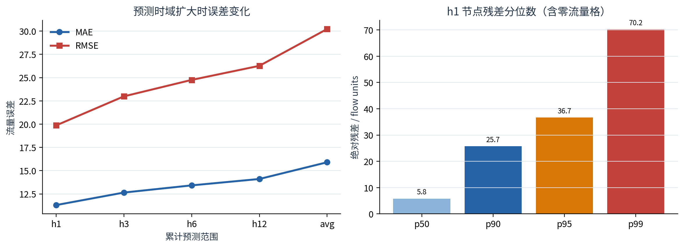
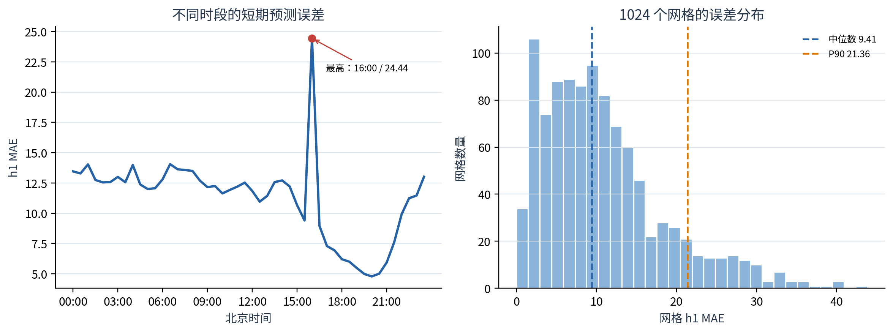
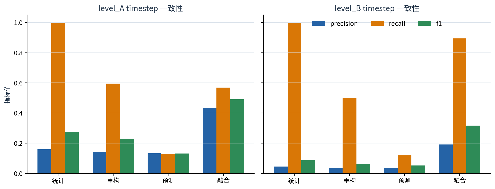
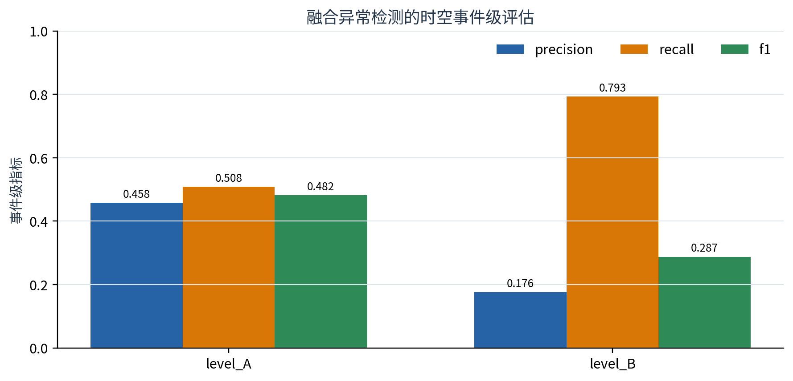

# Week7 最终模型性能评估报告

TaxiBJ · AGFormer gated+linear 四随机种子集成 · 生成日期 2026-08-09

> **结论摘要：** 最终模型在 4,022 个严格 gap-aware 测试窗口上取得 h1 MAE **11.3019**、24 小时平均 MAE **15.9030**。四 seed 均值集成相对最佳单模型的 24 小时平均 MAE 再降低 **1.30%**。异常融合在 Level-A 弱标签上 timestep F1 为 **0.4912**、事件 F1 为 **0.4819**；这些异常指标只表示弱规则一致性，不是真实业务准确率。

## 1. 评估目标与固定口径

- 城市与数据：TaxiBJ，32×32 网格，共 1,024 个节点；
- 输入/输出：过去 48 个半小时步预测未来 48 步，即 24 小时到 24 小时；
- 测试窗口：4,022 个，使用真实时间戳并过滤跨缺口窗口；
- 最终模型：AGFormer，`d_model=32`、4 个注意力头、2 层，输入含流量、时间上下文及 33 维无泄漏静态节点特征，并使用 linear residual head；
- 集成成员：seed 42、7、21、123，预测按算术平均融合；
- 预测指标：对真实值非零位置计算 MAE/RMSE/MAPE，MAPE 使用 `eps=1.0`；
- 模型选择在验证集完成，本报告只汇报固定测试集结果。

## 2. 最终预测精度

| scope | forecast_hours | MAE | RMSE | MAPE | test_windows |
| --- | --- | --- | --- | --- | --- |
| h1 | 0.5000 | 11.3019 | 19.8621 | 23.4913 | 4022 |
| h3 | 1.5000 | 12.6473 | 22.9856 | 26.1838 | 4022 |
| h6 | 3.0000 | 13.4194 | 24.7530 | 28.2789 | 4022 |
| h12 | 6.0000 | 14.1068 | 26.2676 | 30.6591 | 4022 |
| avg | 24.0000 | 15.9030 | 30.2250 | 35.4350 | 4022 |

`h3/h6/h12` 是前 3/6/12 步累计指标，而不是单独第 3/6/12 步；`avg` 汇总全部 48 个预测步。

图1　随着预测时域扩大，误差逐步上升；右图展示 h1 节点绝对残差的长尾。

四个单模型的 24 小时平均结果如下。最佳单模型 seed42 的 MAE 为 16.1132，ensemble 为 15.9030，说明多 seed 平均主要降低了随机初始化带来的方差。

| seed | MAE | RMSE | MAPE |
| --- | --- | --- | --- |
| 42 | 16.1132 | 30.3198 | 36.9075 |
| 7 | 16.9079 | 31.9627 | 39.7537 |
| 21 | 16.4172 | 31.2766 | 36.5076 |
| 123 | 16.5463 | 31.1309 | 38.1018 |

## 3. 时间与空间误差结构

图2　左：h1 MAE 的北京时间分布；右：1,024 个网格的 h1 MAE 分布。

网格 MAE 中位数为 **9.4145**，P90 为 **21.3621**。最困难网格为 grid 157，MAE **43.8480**。时段上 16:00 的误差最高，明显高于相邻时段，提示后续应针对突变日或特殊日期检查该时段的样本构成。

误差最高的时段：

| local_time | MAE | RMSE | MAPE |
| --- | --- | --- | --- |
| 16:00 | 24.4416 | 53.8438 | 66.5362 |
| 06:30 | 14.0519 | 25.2563 | 21.2142 |
| 01:00 | 14.0341 | 24.4249 | 17.7950 |
| 04:00 | 13.9813 | 25.8399 | 19.2839 |
| 07:00 | 13.6271 | 23.5358 | 40.6575 |

误差最高的网格：

| grid_id | MAE | RMSE | MAPE | valid_count |
| --- | --- | --- | --- | --- |
| 157 | 43.8480 | 67.1035 | 23.9579 | 4022 |
| 219 | 40.2592 | 61.4400 | 15.5342 | 4021 |
| 375 | 40.1303 | 64.8538 | 21.5161 | 4022 |
| 126 | 39.9037 | 58.2741 | 19.6989 | 4021 |
| 188 | 39.2566 | 60.7336 | 17.7643 | 4021 |
| 600 | 37.0505 | 58.7574 | 16.1855 | 4022 |
| 597 | 35.4630 | 53.9794 | 18.2355 | 4022 |
| 588 | 35.3833 | 53.1877 | 18.3462 | 4021 |
| 250 | 35.2037 | 52.5031 | 13.7888 | 4020 |
| 281 | 35.0104 | 51.5775 | 21.2021 | 4022 |

## 4. 异常检测 timestep 评估

图3　统计、重构、预测误差和最终融合对两套弱标签的 timestep precision/recall/F1。

最终融合结果：

| label_reference | accuracy | balanced_accuracy | precision | recall | f1 | roc_auc | average_precision |
| --- | --- | --- | --- | --- | --- | --- | --- |
| level_A | 0.9212 | 0.7576 | 0.4322 | 0.5688 | 0.4912 | 0.9335 | 0.4608 |
| level_B | 0.9269 | 0.9111 | 0.1921 | 0.8947 | 0.3163 | 0.9689 | 0.4436 |

Level-A 的 F1 更高，Level-B 的 recall 和 balanced accuracy 更高但 precision 较低。融合结果优于任一单类检测器的 F1，说明三类证据具有互补性；但统计检测同时参与弱标签构造和最终融合（权重 0.70），因此这些数值存在规则相关性。

## 5. 时空事件级评估

图4　事件匹配同时要求时间重叠以及空间 IoU 或质心距离满足阈值。

| label_reference | event_precision | event_recall | event_f1 | true_event_count | pred_event_count | mean_detection_delay_hours |
| --- | --- | --- | --- | --- | --- | --- |
| level_A | 0.4580 | 0.5085 | 0.4819 | 118 | 131 | 0.1833 |
| level_B | 0.1756 | 0.7931 | 0.2875 | 29 | 131 | 0.0217 |

最终双向融合产生 131 个事件。Level-A 参考下事件 F1 为 0.4819；Level-B 参考更严格、事件数更少，recall 达 0.7931，但 precision 下降。匹配采用一对一最大基数匹配，并在非连续 30 分钟时间缺口处强制断开事件。

## 6. 综合判断

1. 最终 AGFormer ensemble 可作为 Week5/Week6 预测误差检测和在线预测服务的固定模型；
2. h1 表现明显优于长时域，Web 端展示 24 小时预测时应同时提示不确定性随时域增长；
3. 网格和时段误差具有显著异质性，grid 157 和 16:00 时段值得后续专项诊断；
4. 异常融合提升了弱标签一致性，但 TaxiBJ 无权威异常真值，不能将 precision/recall 解释为现实事件检测准确率。

## 7. 评估边界与复现

- 预测指标是固定测试集结果，不代表其他城市或未来年份的泛化能力；
- h1 残差分位数图包含零流量格，仅用于描述检测阈值面对的残差分布，不应与 masked MAE 混用；
- 异常 weak label 来自项目统计规则，且最终融合包含统计分支；
- 原始结果位于 `outputs/week7_evaluation/final_system_v1/`，配置为 `configs/week7_evaluation.yaml`；
- 输入结果哈希、依赖版本和环境信息记录在该目录的 `summary.json`。
