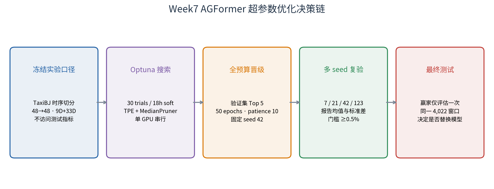

# Week7 超参数优化方案报告

<div class="meta">AGFormer gated-context + linear residual · Optuna 自动优化设计 · 生成日期 2026-08-09</div>

> **方案结论：** 保持 Week4 最终模型的数据规则、特征集合和测试窗口不变，使用 Optuna TPE 在固定验证集上搜索学习率、批次、隐藏维度、注意力头数等 9 组参数。整个 study 的总预算为 **30 trials / 自首次启动起 18 小时软墙钟目标**，单 GPU 串行运行并启用 MedianPruner、早停、显存门禁和 SQLite 状态恢复。搜索与全预算晋级均不构建测试 Dataset；四随机种子确认胜出后，只有显式 `--run-final-test` 才会访问一次测试集。

## 1. 当前基线与优化目标

优化对象是当前最终预测模型，而非重新比较模型家族：

| 项目 | 固定值 |
| --- | --- |
| 模型 | AGFormer，gated 时间/静态上下文，parallel linear residual head |
| 数据 | TaxiBJ，32×32=1,024 节点，真实时间戳，gap-aware 连续窗口 |
| 输入/输出 | 48 个历史半小时步 → 48 个未来半小时步（24 小时） |
| 动态输入 | inflow/outflow + 7 维时间/日历，共 9 维 |
| 静态输入 | 33 维无泄漏节点特征 |
| 图结构 | 单 spatial graph + adaptive adjacency |
| 当前 seed42 基线 | checkpoint epoch 22，验证 avg MAE **17.3917** |
| 已知测试参考 | seed42 avg MAE 16.1132；四 seed ensemble avg MAE 15.9030 |

主目标为固定验证集上、全部 48 个预测步和所有非零真实流量位置的反归一化平均绝对误差：

`objective = masked_MAE(pred × std + mean, true × std + mean)`

Optuna 的方向为 `minimize`。搜索阶段额外记录 train loss、参数量、训练时长和峰值显存作为诊断信息，但不组成加权目标；RMSE/MAPE 只在获得明确授权的最终测试中计算，避免改变项目一直使用 MAE 作为主指标的口径。

## 2. 搜索边界

### 2.1 可优化参数

| 参数 | 搜索范围 | 分布/约束 | 设计理由 |
| --- | --- | --- | --- |
| `lr` | 0.0002–0.002 | 对数均匀 | 覆盖当前 1e-3 附近一个数量级 |
| `batch` | [4, 8] | categorical | 只允许已知安全的 4/8，不冒险并发或 batch 16 |
| `d_model` | [24, 32, 48, 64] | categorical | 同时探索更小与更大表示容量 |
| `n_heads` | [2, 4, 8] | categorical | 运行时强制 `d_model % n_heads == 0` |
| `d_ff` | `d_model × [2, 3, 4]` | 条件派生 | 保持 FFN 宽度与隐藏维度成比例 |
| `num_layers` | [1, 2, 3] | categorical | 检查 1–3 层的容量/过拟合权衡 |
| `dropout` | 0.05–0.25 | 步长 0.05 | 调整正则化强度 |
| `weight_decay` | 1e-06–0.0005 | 对数均匀 | 搜索 AdamW 正则化尺度 |
| `embed_dim` | [8, 10, 16] | categorical | 调整 adaptive adjacency 节点嵌入容量 |

### 2.2 明确冻结的项目

城市、时序切分、`T_in/T_out`、真实时间编码、gap filtering、9 维动态输入、33 维静态特征、single spatial graph、gated fusion、linear residual head、Huber loss、AdamW 和指标掩码规则全部冻结。天气、周期滞后、多图、future decoder context 等特征不进入本轮搜索，因为它们会混淆“超参数优化”和“特征/架构消融”。

## 3. 分阶段执行方案


<div class="figure-caption">图1　搜索、晋级、多随机种子和最终测试之间的隔离关系。</div>

### 阶段 A：配置与资源预检

- 默认命令只解析 YAML、检查冻结字段与搜索空间，不加载数据、不创建 study；
- 正式运行必须显式提供 `--run`；
- CUDA 必须可见，study 启动前至少保留 6144 MiB 空闲显存；
- `n_jobs=1` 被代码强制，禁止多个 trial 同时占用 GPU。

### 阶段 B：Optuna 低预算搜索

- 当前生产参数会作为 incumbent control 主动加入 study，确保搜索结果能在同一代码和预算下直接比较；TPE sampler 的 startup 阶段共 8 个 trials，之后利用历史结果采样；
- 每个 trial 最多 30 epochs，patience=6；
- MedianPruner 在至少 5 epochs 后比较中间验证 MAE，且前 5 个 trial 不剪枝；
- 所有 trial 固定 seed=42，降低随机噪声对结构比较的影响；
- 每轮保存独立 config、`history.jsonl` 和最佳 checkpoint，Optuna 状态保存到 SQLite；重启后继续剩余总预算，而不是重新获得 30 trials/18 小时；
- 中断时处于 RUNNING 的 trial 不原地续训，但会计入总 trial 预算，避免重启突破资源上限；软墙钟预算从 study 首次启动计时并包含停机时间，Optuna 在 trial 之间检查 timeout，正在运行的单个 trial 可能略微越过 18 小时边界；
- study 保存配置、数据和实现文件的 SHA-256 protocol fingerprint；同名数据库若规则漂移将拒绝恢复。

### 阶段 C：全预算晋级

排除主动入队的 incumbent 后，按验证 MAE 选择 Top-5 challengers，自动导出带 `optimization_validation_only=true` 的 YAML，并额外导出 `incumbent_control.yaml`。这些配置会被通用 `scripts/train.py` 主动拒绝，只能通过专用 `train_optuna_promotion.py --run-promotion` 训练；该入口仅构建 train/validation。候选与 control 都用 seed=42、50 epochs、patience=10 在同一环境重训。只有相对同轮 incumbent control 至少改善 0.5% 才晋级多 seed；按历史 checkpoint 估算，对应验证 MAE 约低于 **17.3047**，正式判断以同轮 control 为准。

### 阶段 D：稳健性确认与最终测试

晋级配置使用 seeds [7, 21, 42, 123] 复验，报告验证 MAE 的 mean±std。确认收益稳定后，使用独立 `evaluate_optuna_final.py --run-final-test` 门禁，才会构建与现有模型完全相同的 4,022 个测试窗口并评估 checkpoint；同一 checkpoint 已存在 `final_test_metrics.json` 时会拒绝重复测试。若验证收益不足 0.5%、跨 seed 方差覆盖收益，或最终测试 MAE 未改善，则保留现有最终模型。

## 4. 资源保护与故障恢复

| 风险 | 代码措施 | 结果处理 |
| --- | --- | --- |
| GPU OOM | batch 仅 4/8、参数量上限 2.0M、trial 后清 CUDA cache | OOM 标记为 pruned，不中断整个 study |
| Windows/WSL 重启 | SQLite 状态 + 首次启动时间 + 已消费 trial 计数 | 继续剩余 study 总预算；中断 RUNNING trial 计入预算 |
| 配置或数据漂移 | config/data/code SHA-256 protocol fingerprint | 同名 study 指纹不一致时拒绝恢复 |
| checkpoint 覆盖 | `trial_XXXX/best.pt` 独立路径 | 非最佳 trial 仅删除大 checkpoint，保留 config/history/SQLite |
| 测试泄漏 | objective 只构建 train/validation Dataset | trial 排名中没有 test 指标 |
| 参数不可用 | 配置加载时校验冻结字段、batch 白名单与 head 整除关系 | 在占用 GPU 前失败 |
| 主机卡死 | 单 trial、2 workers、18h soft timeout | 不启用并行 GPU 搜索；单个在途 trial 允许收尾 |

## 5. 代码与产物设计

| 文件 | 作用 |
| --- | --- |
| `configs/week7_optuna_agformer.yaml` | 搜索空间、预算、剪枝、资源和晋级规则 |
| `scripts/optimize_agformer_optuna.py` | 安全 CLI；无 `--run` 时只校验 |
| `src/optimization/week7.py` | 数据冻结、Optuna objective、验证 MAE、SQLite study 与配置导出 |
| `scripts/train_optuna_promotion.py` | Top-5/control 专用 validation-only 全预算训练入口 |
| `scripts/evaluate_optuna_final.py` | 需要 `--run-final-test` 的独立测试集门禁 |
| `tests/test_week7_optimization.py` | 不训练的安全性与条件搜索测试 |

正式搜索完成后，预期产物位于 `outputs/week7_optimization/week7_agformer_optuna_v1/`：

- `study.db`：带总预算和 protocol fingerprint 的可恢复 Optuna study；
- `trials.csv`：所有 trial 的参数、状态和目标值；
- `trials/trial_XXXX/config.yaml` 与 `history.jsonl`：逐 trial 留痕；
- `best_config.yaml`：排名第一的 50-epoch 晋级配置；
- `promotion/configs/rank*_trial*.yaml`：Top-5 晋级配置；
- `promotion/configs/incumbent_control.yaml`：与晋级候选同预算复跑的当前生产参数；
- `summary.json`：最佳 trial、验证 MAE、候选列表与“搜索未访问测试集”声明。

## 6. 预定命令（本次未执行训练）

仅校验配置：

```bash
.venv/bin/python scripts/optimize_agformer_optuna.py \
  --config configs/week7_optuna_agformer.yaml
```

未来获得明确授权后启动搜索：

```bash
.venv/bin/python -u scripts/optimize_agformer_optuna.py \
  --config configs/week7_optuna_agformer.yaml --run
```

搜索结束后，晋级配置仍默认只校验；全预算验证训练需要单独授权：

```bash
.venv/bin/python -u scripts/train_optuna_promotion.py \
  --candidate-config outputs/week7_optimization/week7_agformer_optuna_v1/promotion/configs/rank1_trialXXXX.yaml \
  --run-promotion
```

只有完成多 seed 决策后才执行最终测试门禁：

```bash
.venv/bin/python scripts/evaluate_optuna_final.py \
  --candidate-config outputs/week7_optimization/week7_agformer_optuna_v1/promotion/configs/rank1_trialXXXX.yaml \
  --run-final-test
```

代码不在后台自行启动，不包含自动轮询，也不会因生成本报告而创建 study 或 checkpoint。

## 7. 评估边界与决策规则

1. 首轮 trial 固定一个随机种子，TPE 最优值存在 selection bias；四 seed 复验是必须步骤；
2. 30 trials 对 9 组混合参数不是穷举，只是在单机预算下寻找局部更优区域；
3. MedianPruner 可能提前淘汰慢热配置，Top-5 全预算阶段用于缓解该问题；
4. batch size 会改变梯度噪声，不能只按吞吐量选择；所有候选仍以验证 MAE 排名；
5. 最终替换模型必须同时满足：数据规则一致、验证改善达到门槛、四 seed 结果稳定、相同测试窗口 MAE 改善；
6. 本文是**可执行方案**而不是优化结果报告；截至生成时没有运行任何 Optuna trial，因此不报告虚构的 best params 或性能提升。
