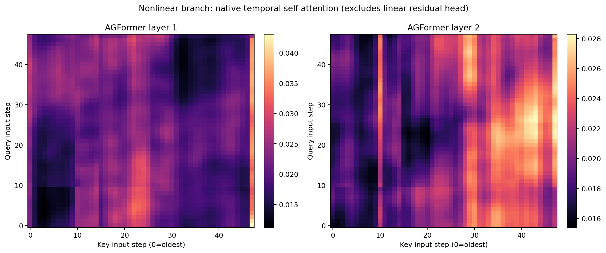
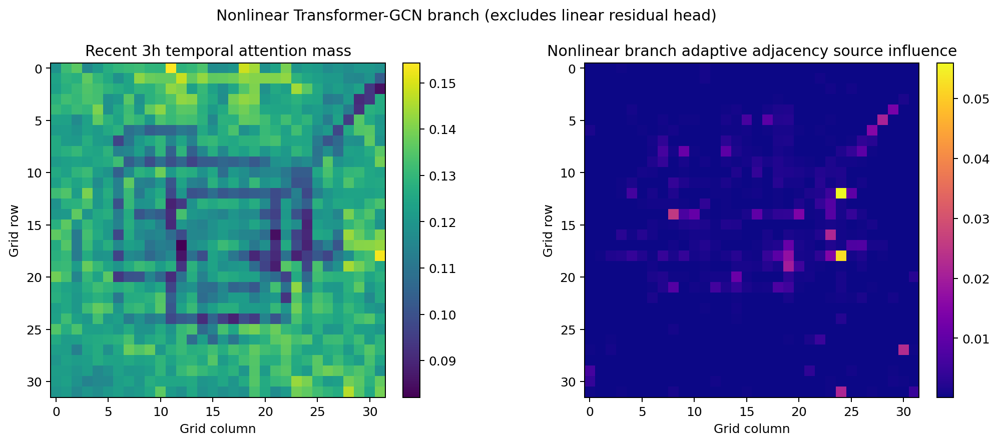
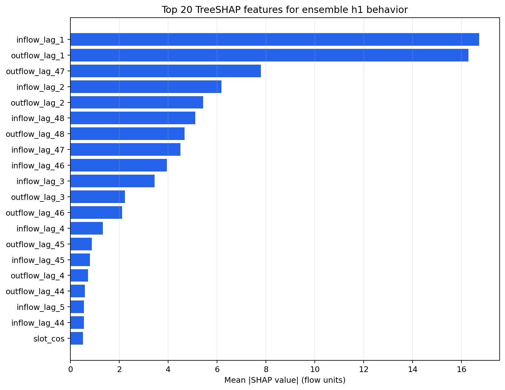
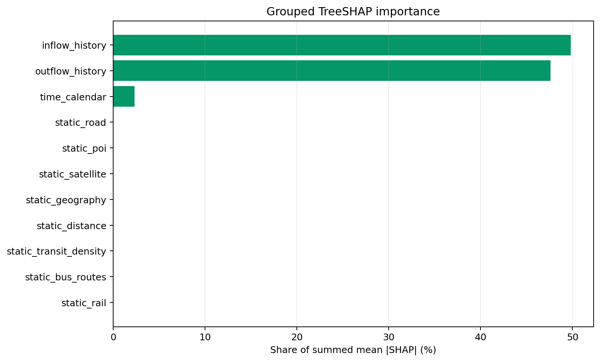
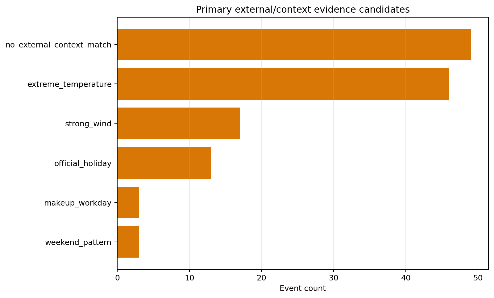
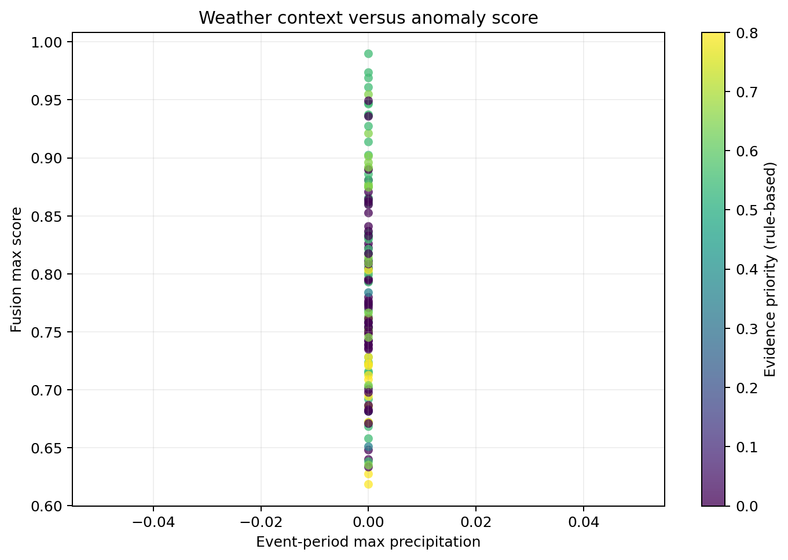

# Week7 模型可解释性分析报告

最终 AGFormer 四 seed ensemble · 注意力、TreeSHAP 与异常上下文证据 · 生成日期 2026-08-09

> **结论摘要：** 跨四个 checkpoint、四个日期和各层聚合后的非线性 Transformer-GCN 平均时间注意力画像较为分散，其归一化熵为 **0.9956**；TreeSHAP 代理显示历史流量合计贡献占 **97.43%**，日历上下文占 2.33%。131 个异常事件中有 82 个找到天气或日历候选证据，49 个没有外部上下文匹配。所有结论均为模型行为或相关证据，不是因果证明。

## 1. 解释对象与三类方法

| 分析 | 解释对象 | 方法 | 主要边界 |
| --- | --- | --- | --- |
| 时间/空间注意力 | 非线性 Transformer-GCN 分支 | 原生 head-averaged attention 与 adaptive adjacency | 不覆盖 parallel linear residual head |
| 特征重要性 | 完整四 seed ensemble 的 h1 输出 | 时间留出的 ExtraTrees 行为代理 + TreeSHAP | 解释代理近似，不是直接模型梯度 |
| 异常原因 | 131 个融合异常事件 | 天气、日历、形态和可选外部事件匹配 | 候选证据，不是校准概率或因果结论 |

模型输入规则与最终评估一致：TaxiBJ、4,022 个 gap-aware 测试窗口、48 步历史流量、7 个时间/日历通道和 33 维无泄漏静态节点特征。

## 2. 时间注意力分析

注意力抽样覆盖测试集首、中、末四个日期，窗口索引为 [0, 1340, 2680, 4021]。这是一组定性覆盖样本，不是全测试集的统计估计。

图1　两层 AGFormer 非线性分支的平均时间注意力矩阵及最后 query 的 lag profile。

最后 query 权重最高的滞后：

| layer | lag_steps | lag_hours | attention_weight |
| --- | --- | --- | --- |
| 1 | 25 | 12.5000 | 0.0298 |
| 1 | 20 | 10.0000 | 0.0280 |
| 1 | 26 | 13.0000 | 0.0277 |
| 1 | 19 | 9.5000 | 0.0276 |
| 1 | 22 | 11.0000 | 0.0271 |
| 2 | 0 | 0.0000 | 0.0264 |
| 2 | 18 | 9.0000 | 0.0263 |
| 2 | 19 | 9.5000 | 0.0258 |
| 2 | 17 | 8.5000 | 0.0253 |
| 2 | 37 | 18.5000 | 0.0242 |

- 最近 3 小时注意力质量占比：**0.1223**；
- 平均时间注意力归一化熵：**0.9956**。

接近 1 的熵说明**聚合后的平均 attention profile** 未集中在少数时间步；不同模型或窗口各自集中的注意力也可能在平均后呈现分散，因此不能将该结论外推到每个样本。第一层的聚合画像较关注约 9.5–13 小时前的输入，第二层同时关注最近时刻与 8.5–9.5 小时前信息。由于最终模型存在 linear residual head，不能据此断言最终预测主要由这些滞后驱动。

## 3. 空间自适应邻接分析

图2　非线性分支 adaptive adjacency 的节点集中度、熵及网络摘要。

- adaptive adjacency 平均行熵：**0.7261**；
- 每个目标节点 top-k 权重平均集中度：**0.2238**。

该图显示模型学习到了非均匀节点关系，但只覆盖 learned adaptive graph。预定义 spatial GCN 和 parallel linear residual head 是独立路径，因此这里不是完整空间贡献分解。

## 4. TreeSHAP 全局特征重要性

代理模型使用前 80% 测试窗口拟合、后 20% 时间留出验证，验证 R² 为 **0.9926**、MAE 为 **4.4381** flow units。SHAP 平均加法误差为 0.00000413，说明 TreeSHAP 分解本身数值一致。

图3　完整 ensemble h1 行为代理的单特征 mean |SHAP| 排名。

| importance_rank | feature | feature_group | mean_abs_shap | mean_signed_shap |
| --- | --- | --- | --- | --- |
| 1 | inflow_lag_1 | inflow_history | 16.7158 | -1.1349 |
| 2 | outflow_lag_1 | outflow_history | 16.2779 | -0.1694 |
| 3 | outflow_lag_47 | outflow_history | 7.7937 | -0.0081 |
| 4 | inflow_lag_2 | inflow_history | 6.1749 | -0.2881 |
| 5 | outflow_lag_2 | outflow_history | 5.4363 | -0.3500 |
| 6 | inflow_lag_48 | inflow_history | 5.1043 | -0.1255 |
| 7 | outflow_lag_48 | outflow_history | 4.6723 | -0.1573 |
| 8 | inflow_lag_47 | inflow_history | 4.5031 | 0.0096 |
| 9 | inflow_lag_46 | inflow_history | 3.9451 | 0.0822 |
| 10 | inflow_lag_3 | inflow_history | 3.4422 | -0.0439 |
| 11 | outflow_lag_3 | outflow_history | 2.2361 | -0.1025 |
| 12 | outflow_lag_46 | outflow_history | 2.1179 | -0.1617 |
| 13 | inflow_lag_4 | inflow_history | 1.3223 | 0.0021 |
| 14 | outflow_lag_45 | outflow_history | 0.8772 | -0.0212 |
| 15 | inflow_lag_45 | inflow_history | 0.7994 | -0.1005 |

排名靠前的特征集中在最近 1–4 个半小时步和输入窗口末端的 lag 46–48，说明模型行为同时依赖短期惯性和接近前一日同一位置的历史边界信息。

图4　按流量、日历与静态节点特征组汇总的 mean |SHAP| 占比。

| feature_group | feature_count | mean_abs_shap | importance_share |
| --- | --- | --- | --- |
| inflow_history | 48 | 44.2893 | 0.4980 |
| outflow_history | 48 | 42.3530 | 0.4763 |
| time_calendar | 7 | 2.0730 | 0.0233 |
| static_road | 5 | 0.0397 | 0.0004 |
| static_poi | 11 | 0.0395 | 0.0004 |
| static_satellite | 5 | 0.0385 | 0.0004 |
| static_geography | 4 | 0.0381 | 0.0004 |
| static_distance | 2 | 0.0238 | 0.0003 |
| static_transit_density | 3 | 0.0211 | 0.0002 |
| static_bus_routes | 1 | 0.0080 | 0.0001 |
| static_rail | 2 | 0.0060 | 0.0001 |

历史 inflow/outflow 合计占 97.43%，日历上下文占 2.33%。静态特征单组占比较小，但这不等于静态特征“无用”：代理输入压缩、门控交互以及模型对不同节点的条件化效应都会降低简单全局 mean |SHAP|。

## 5. 异常上下文证据

图5　131 个融合事件的首要上下文候选分布。

| primary_context_candidate | primary_evidence_type | event_count | mean_max_score |
| --- | --- | --- | --- |
| no_external_context_match | none | 49 | 0.7768 |
| extreme_temperature | weather | 46 | 0.8177 |
| strong_wind | weather | 17 | 0.8032 |
| official_holiday | calendar | 13 | 0.7081 |
| makeup_workday | calendar | 3 | 0.8445 |
| weekend_pattern | calendar | 3 | 0.7054 |

图6　异常事件对应的温度、风速与检测分数分布。

- 天气覆盖率：100.00%；
- 节假日事件：13 个；周末事件：19 个；调休工作日：3 个；
- 未配置外部新闻/活动表，因此匹配新闻事件数为 0；
- `event_type` 只保留为检测器形态标签，不冒充现实原因。

## 6. 综合解释

1. 完整模型仍以历史流量为主，linear residual head 与最近时刻特征共同强化了短期惯性；
2. 非线性注意力分支呈高熵、分散式聚合，更像对多个时间位置的补充校正，而不是单一关键 lag 选择器；
3. learned adaptive graph 存在节点选择性，但不能替代预定义空间图的解释；
4. 天气和日历能为部分异常提供合理上下文，49 个事件没有外部匹配，报告应保持“未知”而不是强行分类原因。

## 7. 解释边界与复现

- Attention 不等于特征贡献，更不等于因果关系；
- TreeSHAP 解释的是高拟合度代理，必须与 R²/MAE 一起阅读；
- 代理的日历特征只取上下文最后时刻，流量特征保留完整 48 步；
- 当前无新闻表，任何现实事件归因均未得到外部来源验证；
- 原始 CSV、NPZ、图片、模型和 manifest 位于 `outputs/week7_interpretability/final_system_v1/`，正式配置为 `configs/week7_interpretability.yaml`。
