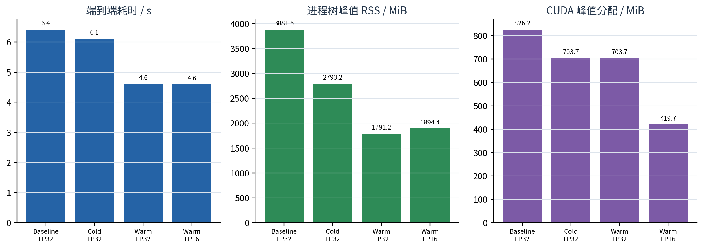
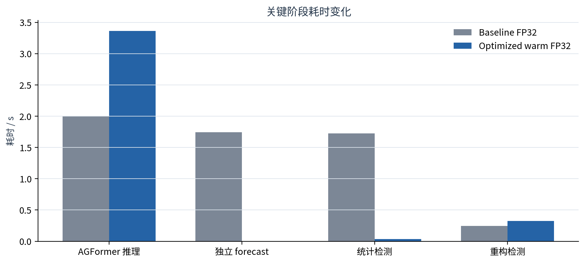
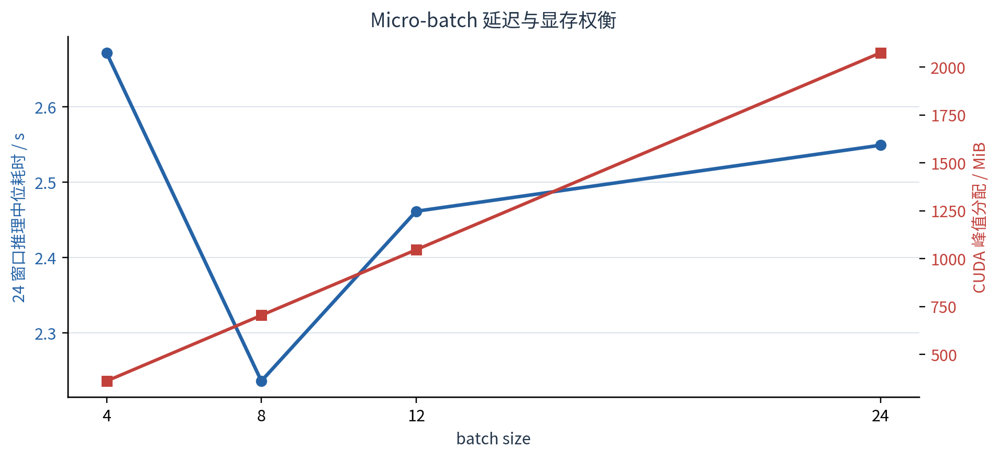
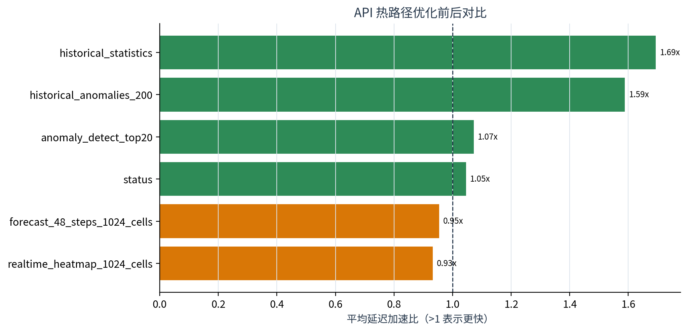

# Week7 系统性能测试报告

Week6 生产流水线与 FastAPI 服务 · 固定 TaxiBJ 24 窗口基准 · 生成日期 2026-08-09

> **结论摘要：** 生产可部署的 FP32 执行优化将暖启动流水线从 **6.416s** 降至 **4.613s**，端到端加速 **1.39×**；进程树 RSS 汇总下降 53.9%，CUDA 峰值分配下降 14.8%。FP16 精度门槛通过但本轮速度门槛未通过，动态 INT8 只保留为 CPU fallback 候选，生产继续使用 FP32。

## 1. 测试对象与控制变量

- 固定输入：测试集末尾 24 个连续有效窗口；
- 固定模型：AGFormer gated+linear 四 seed ensemble；
- 固定输出：h1 异常残差、48 步同 origin 预测、三类异常分数、融合掩码与事件；
- baseline：batch=8、2 个 DataLoader workers、分别执行 h1 与 forecast、每次重拟合统计量；
- optimized：batch=8、worker=0、共享 full-sequence 推理、统计缓存、关闭未使用注意力矩阵物化；
- 每个 pipeline variant 单次顺序执行；API 每端点 2 次 warm-up + 100 次本机顺序请求。

## 2. 端到端耗时与资源

| name | pipeline_seconds | model_inference_seconds | forecast_inference_seconds | statistical_seconds | peak_rss_mib | cuda_peak_allocated_mib |
| --- | --- | --- | --- | --- | --- | --- |
| baseline_fp32 | 6.4161 | 2.0058 | 1.7411 | 1.7231 | 3881.5195 | 826.2471 |
| optimized_cold_fp32 | 6.1063 | 3.0868 | 0.0000 | 1.9276 | 2793.1953 | 703.7471 |
| optimized_warm_fp32 | 4.6133 | 3.3640 | 0.0000 | 0.0377 | 1791.1523 | 703.7471 |
| optimized_warm_fp16 | 4.5962 | 3.3825 | 0.0000 | 0.0336 | 1894.3789 | 419.6846 |

图1　各执行策略的端到端耗时、进程树 RSS 汇总和 CUDA 峰值分配。

暖启动 FP32 是正式生产候选：端到端加速 1.39×，同时减少 worker 带来的进程树 RSS。冷启动 FP32 仍需构建统计缓存，因此只获得较小收益。

## 3. 瓶颈定位与代码优化

图2　baseline 与 optimized warm FP32 的关键阶段耗时。

| 瓶颈 | 修改 | 结果 |
| --- | --- | --- |
| h1 与 Web forecast 重复加载四个 checkpoint 并重复前向 | 24 个窗口一次输出完整序列，h1 与最新 forecast 共享 | 独立 forecast 阶段由 1.741s 降至近 0 |
| 每次实时调用都拟合 inflow/outflow slot statistics | 以数据 SHA256、train_len、时区与规则参数构建指纹缓存 | 统计阶段由 1.723s 降至 0.038s |
| MultiheadAttention 默认返回但调用方丢弃权重 | 普通预测 `need_weights=False`，XAI 时显式开启 | FP32 fusion mask 保持完全一致 |
| 24 窗口仍启动 2 个 DataLoader workers | 实测后改为 worker=0 | 减少进程树 RSS 与启动开销 |
| API 每次重新转换事件时间并循环映射坐标 | mtime-aware 派生缓存 + vectorized merge | 历史事件/统计端点明显加速 |

## 4. Batch size 扫描

图3　24 个窗口、四模型 ensemble 在不同 micro-batch 下的延迟与 CUDA 显存。

| batch_size | latency_seconds_median | latency_seconds_min | latency_seconds_max | cuda_peak_allocated_mib_max | max_abs_diff_vs_first_batch |
| --- | --- | --- | --- | --- | --- |
| 4 | 2.6718 | 2.3823 | 2.9613 | 360.4971 | 0.0000 |
| 8 | 2.2359 | 2.1229 | 2.3489 | 703.7471 | 0.0000 |
| 12 | 2.4614 | 2.3596 | 2.5632 | 1045.9971 | 0.0000 |
| 24 | 2.5491 | 2.4911 | 2.6071 | 2074.2471 | 0.0000 |

batch=8 的中位延迟最低；batch=24 将峰值显存推至约 2,074 MiB，速度反而变慢。因此正式配置选择 batch=8，而不是盲目使用最大 batch。

## 5. 数值一致性门禁

- FP32 scores 的 fusion mask 不一致率：**0.0**；
- FP32 h1 `pred_flow` 最大绝对差：**0.00012207**；
- forecast 的 city/member/origin/timestamps 完全一致，target indices/step 完全一致；
- 48×1024 forecast 最大绝对差：**0.00009155**，低于 0.001 门槛；
- 正式判断：`deploy_fp32_execution_optimizations=True`。

## 6. FP16 与动态 INT8

FP16 对四个时期的 256 个窗口进行了补充核验：masked MAE 从 10.305124 变为 10.305077，变化 -0.000048；融合掩码不一致率为 0.0。质量门槛通过，但同轮模型推理加速比仅 **0.9945×**，低于 1.05，因此 `deploy_fp16=False`。

CPU dynamic INT8 microbenchmark 的速度比为 1.305×，state_dict 仅缩小 1.24%，且只覆盖单模型、单窗口和 Linear 动态量化。当前生产推理在 CUDA 上运行，因此不部署 INT8，只把它记录为 CPU fallback 候选。

## 7. API 响应性能

图4　优化后平均延迟相对 Week7 初始固定 API 基线的比值。

| endpoint | mean_ms_baseline | mean_ms_optimized | p95_ms_baseline | p95_ms_optimized | mean_speedup | result |
| --- | --- | --- | --- | --- | --- | --- |
| status | 1.3308 | 1.2725 | 1.4688 | 1.5758 | 1.0458 | faster |
| realtime_heatmap_1024_cells | 12.4769 | 13.3823 | 13.2446 | 15.9920 | 0.9323 | slower/noise |
| forecast_48_steps_1024_cells | 41.8862 | 43.9020 | 43.0060 | 46.6114 | 0.9541 | slower/noise |
| anomaly_detect_top20 | 4.3330 | 4.0410 | 5.3741 | 5.0019 | 1.0723 | faster |
| historical_anomalies_200 | 19.4158 | 12.2232 | 20.7733 | 13.7642 | 1.5884 | faster |
| historical_statistics | 16.8250 | 9.9307 | 18.0365 | 11.7588 | 1.6942 | faster |

历史事件查询和统计端点分别约加速 1.59× 与 1.69×。热力图和 48×1024 forecast 的完整 JSON 响应本轮略慢，说明它们主要受 Python 对象构造、JSON 序列化和 gzip 压缩限制；不应宣称 API 全面加速。

优化后 API 冷启动 0.511s，空闲 RSS 125.75 MiB，基准期间峰值 RSS 137.39 MiB。

## 8. 测量边界与后续加固

1. pipeline variant 各运行一次且顺序固定，小差异可能受系统调度影响；
2. `peak_rss_mib` 是进程树 RSS 求和，共享页可能重复计算，不等同于物理 PSS；
3. API 是单客户端 loopback，不包含公网、反向代理、浏览器渲染和并发压力；
4. 统计缓存按当前单进程顺序运行设计；并行 writer 场景应增加 file lock 或唯一临时文件；
5. FP16/INT8 都由显式质量与速度门槛控制，本轮生产配置保持 FP32；
6. 正式结果位于 `outputs/week7_performance/final_system_v5/`，配置为 `configs/week7_performance.yaml`。
