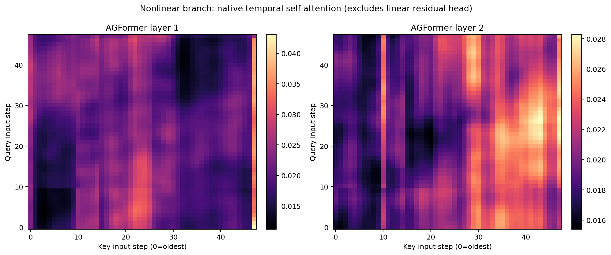
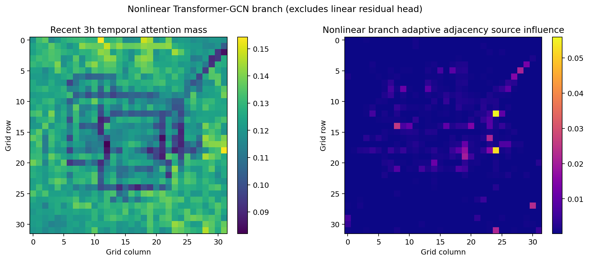
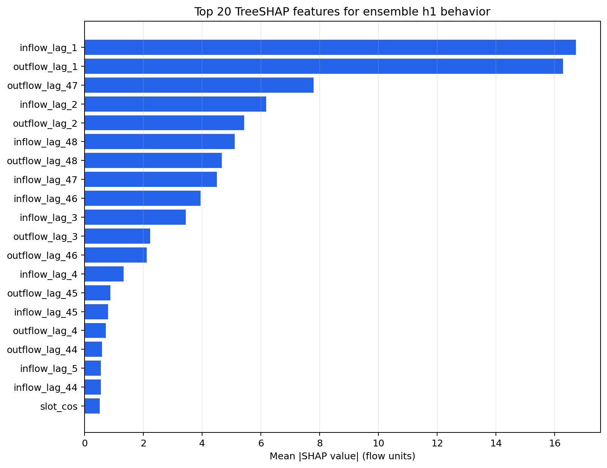
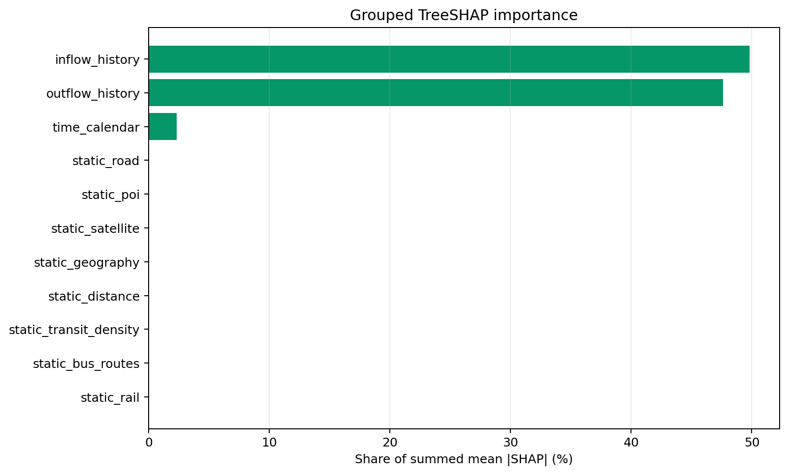
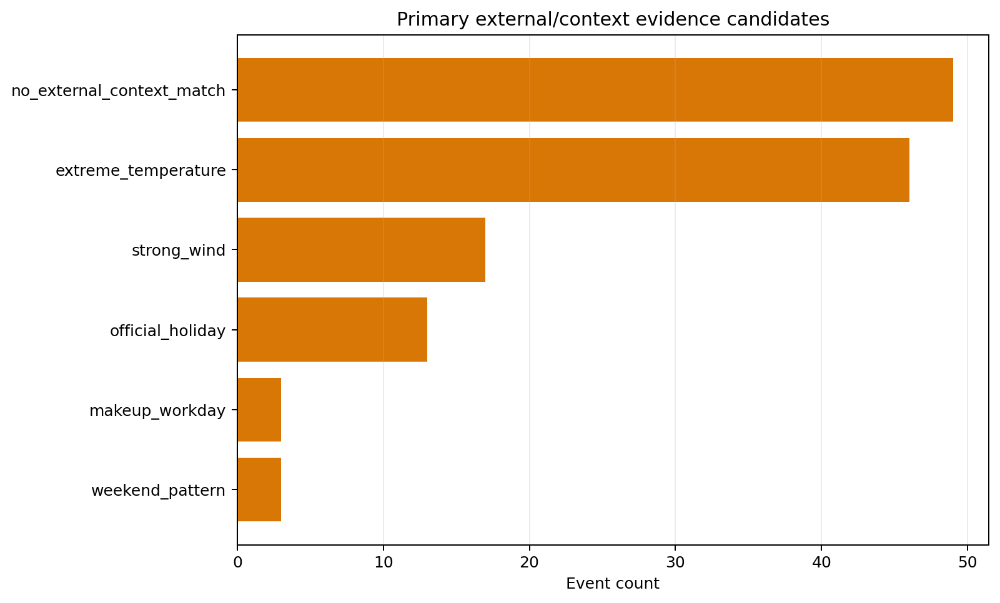
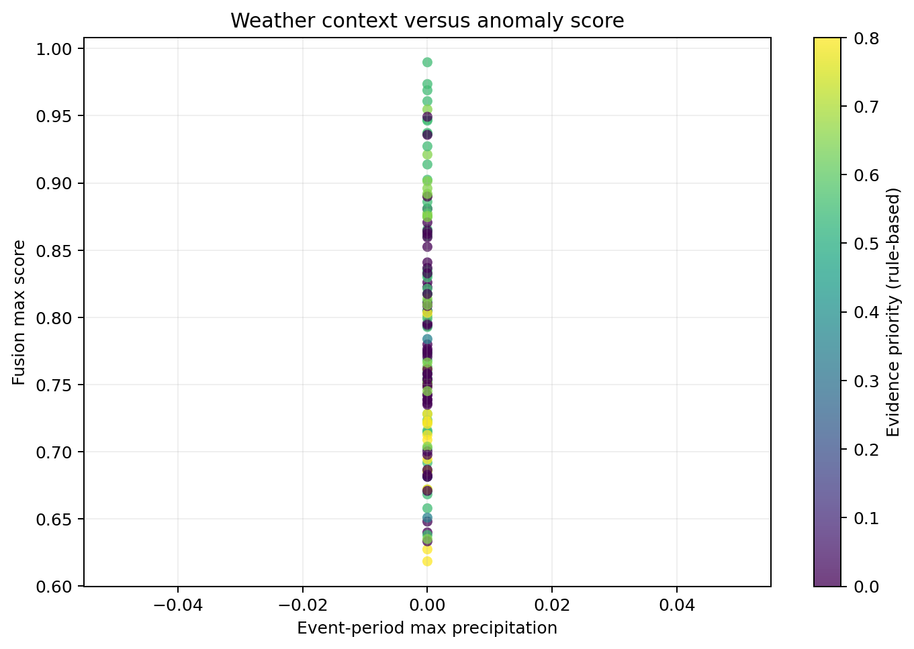

# Week7 第三阶段：模型可解释性分析

生成时间：2026-08-09T12:45:06+00:00

## 1. 范围与方法

- 解释对象：Week4 最终 AGFormer gated+linear 四随机种子均值 ensemble；
- 数据规则：TaxiBJ、4022 个 gap-aware 测试窗口、48 步输入、33 维无泄漏静态特征；
- 注意力部分直接提取四个 checkpoint 非线性 Transformer-GCN 分支的真实、head-averaged 时序注意力，并分析该分支的 learned adaptive adjacency；
- 最终 checkpoint 启用了并行 linear residual head，它绕过 Transformer/GCN，因此注意力图不覆盖完整最终输出；
- SHAP 部分使用时间留出的 ExtraTrees 模型行为代理解释保存的完整 ensemble h1 预测，包含 linear head 的效果；7 个日历特征只表示目标前最后一个上下文时刻，96 个流量特征保留完整 48 步；
- 异常原因部分只输出天气、日历、形态和可选外部事件的候选证据，不将相关性写成因果结论。

## 2. 时间与空间注意力

这是覆盖 4 个日期的定性抽样分析，不代表全部 4022 个测试窗口的注意力分布。抽样测试窗口：[0, 1340, 2680, 4021]。

最后 query 最关注的输入滞后：

| layer | lag_steps | lag_hours | attention_weight |
| --- | --- | --- | --- |
| 1 | 25 | 12.5000 | 0.0298 |
| 1 | 20 | 10.0000 | 0.0280 |
| 1 | 26 | 13.0000 | 0.0277 |
| 1 | 19 | 9.5000 | 0.0276 |
| 1 | 22 | 11.0000 | 0.0271 |
| 2 | 0 | 0.0000 | 0.0264 |
| 2 | 18 | 9.0000 | 0.0263 |
| 2 | 19 | 9.5000 | 0.0258 |
| 2 | 17 | 8.5000 | 0.0253 |
| 2 | 37 | 18.5000 | 0.0242 |

- 最近 3.0 小时平均注意力权重占比（attention mass）：0.1223；
- 平均时序注意力归一化熵：0.9956；
- adaptive adjacency 平均行熵：0.7261；
- 每个目标节点 top-k adaptive 权重平均集中度：0.2238。

这里的时间与空间图只解释非线性 Transformer-GCN 分支。AGFormer 同时使用预定义 spatial GCN，并通过并行 linear residual head 直接将历史 inflow 映射到输出；因此不能把这些图当成完整最终预测的贡献分解。Attention 也不等同于因果重要性。

## 3. TreeSHAP 特征重要性

代理模型在时间留出数据上的拟合度：R²=0.9926，MAE=4.4381 flow units。SHAP 加法平均绝对误差为 0.000004。

| importance_rank | feature | feature_group | mean_abs_shap | mean_signed_shap |
| --- | --- | --- | --- | --- |
| 1 | inflow_lag_1 | inflow_history | 16.7158 | -1.1349 |
| 2 | outflow_lag_1 | outflow_history | 16.2779 | -0.1694 |
| 3 | outflow_lag_47 | outflow_history | 7.7937 | -0.0081 |
| 4 | inflow_lag_2 | inflow_history | 6.1749 | -0.2881 |
| 5 | outflow_lag_2 | outflow_history | 5.4363 | -0.3500 |
| 6 | inflow_lag_48 | inflow_history | 5.1043 | -0.1255 |
| 7 | outflow_lag_48 | outflow_history | 4.6723 | -0.1573 |
| 8 | inflow_lag_47 | inflow_history | 4.5031 | 0.0096 |
| 9 | inflow_lag_46 | inflow_history | 3.9451 | 0.0822 |
| 10 | inflow_lag_3 | inflow_history | 3.4422 | -0.0439 |
| 11 | outflow_lag_3 | outflow_history | 2.2361 | -0.1025 |
| 12 | outflow_lag_46 | outflow_history | 2.1179 | -0.1617 |
| 13 | inflow_lag_4 | inflow_history | 1.3223 | 0.0021 |
| 14 | outflow_lag_45 | outflow_history | 0.8772 | -0.0212 |
| 15 | inflow_lag_45 | inflow_history | 0.7994 | -0.1005 |

| feature_group | feature_count | mean_abs_shap | importance_share |
| --- | --- | --- | --- |
| inflow_history | 48 | 44.2893 | 0.4980 |
| outflow_history | 48 | 42.3530 | 0.4763 |
| time_calendar | 7 | 2.0730 | 0.0233 |
| static_road | 5 | 0.0397 | 0.0004 |
| static_poi | 11 | 0.0395 | 0.0004 |
| static_satellite | 5 | 0.0385 | 0.0004 |
| static_geography | 4 | 0.0381 | 0.0004 |
| static_distance | 2 | 0.0238 | 0.0003 |
| static_transit_density | 3 | 0.0211 | 0.0002 |
| static_bus_routes | 1 | 0.0080 | 0.0001 |
| static_rail | 2 | 0.0060 | 0.0001 |

这些 SHAP 值解释的是“代理模型如何近似最终 ensemble 的完整 h1 输出”，其中包含 linear residual head。只有在代理 R² 足够高时，才适合把全局排序视为完整 AGFormer 行为的近似；它不是对四个 checkpoint 的直接梯度 SHAP。

## 4. 异常外部/上下文证据分析

共分析 131 个融合异常事件，天气覆盖率 100.00%；节假日事件 13 个，周末事件 19 个，调休工作日事件 3 个。
周末与调休工作日是两个独立标记，计数可能重叠。

| primary_context_candidate | primary_evidence_type | event_count | mean_max_score |
| --- | --- | --- | --- |
| no_external_context_match | none | 49 | 0.7768 |
| extreme_temperature | weather | 46 | 0.8177 |
| strong_wind | weather | 17 | 0.8032 |
| official_holiday | calendar | 13 | 0.7081 |
| makeup_workday | calendar | 3 | 0.8445 |
| weekend_pattern | calendar | 3 | 0.7054 |

外部新闻/活动表已配置：False；匹配事件数：0。检测器的 `event_type` 仅作为 morphology label 单独保留，不再作为外部原因。`evidence_priority` 是手工证据排序，不是校准概率。当前未配置新闻表时，结果不会声称任何新闻事件已经得到验证；未来只有带网格中心/半径的记录才是时空匹配，否则明确标记为全市时间共现。

## 5. 解释边界

1. 注意力权重只说明非线性 Transformer-GCN 分支的信息聚合方式，不覆盖并行 linear residual head，也不天然等于特征贡献或因果关系；
2. adaptive adjacency 不包含预定义 spatial GCN 或 linear residual head 的贡献；
3. TreeSHAP 解释的是经过时间留出验证的模型行为代理，应结合代理 R² 阅读；
4. TaxiBJ 没有权威异常真标签，天气、节假日和时空上下文只能提供候选证据；
5. 新闻或活动必须通过带来源和 URL 的外部事件 CSV 显式注入；没有空间字段时只算全市时间共现，系统不会自动编造因果匹配。
